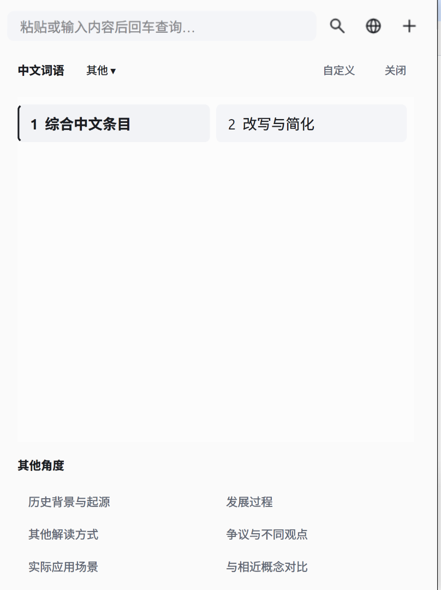
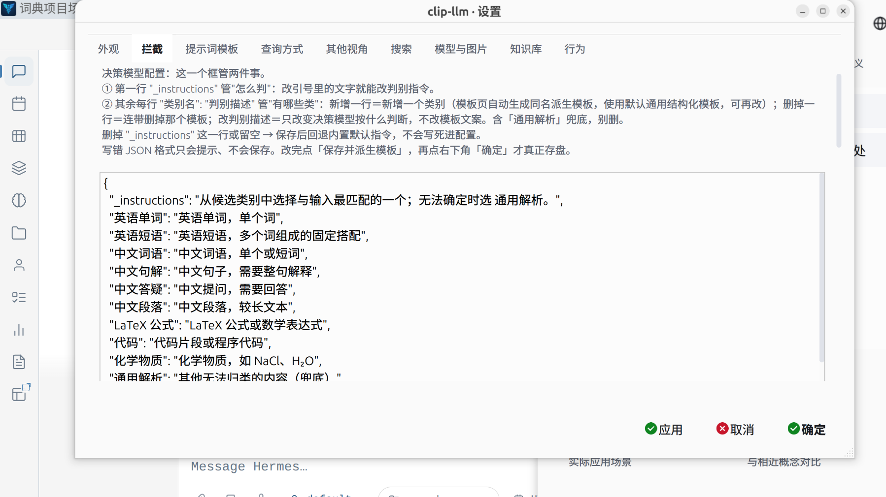
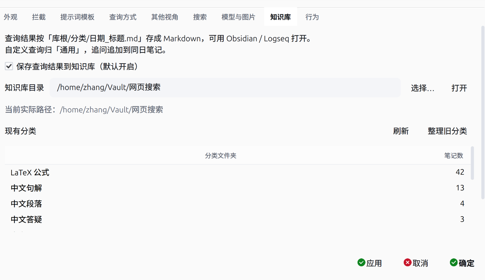

<div align="center">
  
  <h1>clip-llm</h1>
  <p><strong>复制一段内容，先看懂它，再决定让模型解释哪一面。</strong></p>
  <p>本地优先的 Linux 桌面「内容解释词典」· 双层界面 · 初判零 token</p>
  <p>
    <a href="https://github.com/yzbjxh888/clip-llm/releases"></a>
    
    
    <a href="LICENSE"></a>
  </p>
</div>

<p align="center">
  
  
</p>
<p align="center"><em>初判页：本地先判出类别（如「中文词语」/「物理」），列出该类别下的查询方式与 6 个通用「其他角度」；「其他 ▾」可手动改判</em></p>

---

## 它解决什么问题

看到一段英文、一个公式、一段代码或一张截图，通常的做法是把它整段丢给大模型问「这是什么」。结果是：每次都花 token、答案角度单一、你想要的信息往往不在里面。

`clip-llm` 把这件事拆成两步：

1. **本地先判断**——用规则和特征识别内容类别，列出针对这类内容的多种解释方式。**这一步完全在本机完成，不发网络请求、不消耗 token。**
2. **你选一种，模型再答**——只把你点选的那一种角度连同原文组装成提示词，发给**你自己配置的** OpenAI 兼容模型。结果渲染成结构化卡片，还能在同一页继续追问。

> 设计原则：**分类器只缩小选项空间，用户决定解释意图，模型只负责执行。**

即使一项模型配置都没填，也能打开软件体验完整界面和本地初判；这时第二层只显示本地查询预览，不会联网。

---

## 快速开始

### 安装

从 [Releases](https://github.com/yzbjxh888/clip-llm/releases) 下载对应版本的 `.deb`（以发布页实际提供的版本为准）：

```bash
sudo dpkg -i clipllm02_0.2.45_amd64.deb
clipllm02-doctor          # 自检：解释器 / 包导入 / PySide6 / 环境
clipllm02-desktop         # 启动
```

包内自带最小虚拟环境（仅 `PySide6-Essentials`），源码位于 `/opt/clipllm02/src`，不依赖 editable 安装记录。校验值随 Release 一同发布。

### 从源码运行

需要 Python ≥ 3.10；桌面界面需要 `PySide6-Essentials >= 6.8`。

```bash
git clone https://github.com/yzbjxh888/clip-llm.git
cd clip-llm
bash scripts/setup.sh                 # 重建最小 venv + 跑回归测试
.venv/bin/clipllm02-desktop           # 启动
```

### 第一次使用：配置模型

1. 启动软件，按 `F3` 打开**设置**窗口。
2. 切到「**模型与图片**」页，填写三项：**API 地址、API Key、模型名称**。
3. 保存后即可使用。软件只要求 OpenAI 兼容的 `/chat/completions` 接口，**不绑定任何厂商**；视觉模型可单独填写，留空则复用文本模型的地址和 Key。

任一项留空都不会发送网络请求——这是刻意设计的，方便先体验界面。配置只写入本机 `~/.config/clip-llm02/settings.json`，仓库和安装包都不含任何密钥。

---

## 怎么用

### 1. 复制内容 → 本地初判

复制文字或图片，窗口自动弹出（软件同时监听剪贴板变化）。它先给出类别，再把该类别下**全部启用的查询方式**列出来，而不是只给一个「问模型」的按钮：

- 顶栏类别标签（如「中文词语」「化学物质」）显示初判结果；点「其他 ▾」可切换到别的类别，只重建菜单、不发请求。
- 初判来源二选一（在设置里切换）：**本地分类器**（正则规则，零 token）或**决策模型**（SystemOne，短文本）。决策模型无结果时明确提示手动选，不静默回退。
- 查询方式带数字序号，但**不是数字键快捷键**；用鼠标点选，或用方向键配合回车。
- 「自定义」可展开一个自由输入框，直接写你想要的解释要求。
- 「其他角度」最多展示 6 条通用视角（历史背景、争议、应用场景等），与类别无关，始终常驻。
- 命中硬拦截规则（密钥、超长、URL 等）时**完全静默**——不弹窗、不发请求。

### 2. 选一种方式 → 看结构化结果

点选后在同一标签页内切换到结果层，不另开窗口：

<p align="center">
  
</p>
<p align="center"><em>JSON / Markdown 渲染成表格、定义、列表与公式；底部输入框可直接追问</em></p>

- 返回内容会解析成字段表、列表、定义卡片与公式（LaTeX 转 Unicode）。
- 结果下方输入框回车即可**追问**，上下文自动带上，在同一张卡片里追加问答气泡。
- 在结果上选中文本右键，可直接复制、用默认源网页搜索，或用选中文本开一个新标签查询。

### 3. 图片与截图

- **复制图片**：直接复制截图或图片到剪贴板，软件会单独监听并弹出初判。默认超过 **2 MB** 的图片不自动弹窗（可在设置里调整，`0` 表示不限制）。
- **系统截图**：按 `Ctrl+Alt+S` 进入区域截图，识别后先出菜单。**识别结果默认不会自动续跑文本初判**，由你决定下一步。
- 图片识别支持四种内置方式：OCR 提取、表格识别、图片理解、原图标注。
- 图片与文本同时出现时按「图片优先」处理；同一次复制的图片/文本双通道会互相抑制，避免重复弹窗。

### 4. 设置：一切都可插拔

按 `F3` 打开设置窗口，共 9 个页签：

`外观 → 拦截 → 提示词模板 → 查询方式 → 其他视角 → 搜索 → 模型与图片 → 知识库 → 行为`

下面按页签说明每张截图对应的功能。

#### 拦截页：决策模型配置（唯一事实源）

<p align="center">
  
</p>
<p align="center"><em>一个 JSON 框管两件事：第一行 <code>_instructions</code> 是判别指令，其余每行「类别名:判别描述」定义类别清单</em></p>

这里是整个配置的**唯一事实源**：改一行类别就新增一个类别（提示词模板自动生成同名派生模板）；删一行就连带删掉模板；改判别描述只改变决策模型按什么判断、不动模板文案。含「通用解析」兜底类别，别删。保存时校验 JSON 格式，写错只会提示、不会保存。

#### 提示词模板页：文本模板 + 图片模板

<p align="center">
  
</p>
<p align="center"><em>文本模板决定「怎么解释」，支持改 prompt / sections / fields 的完整 JSON；标「来自决策模型」的模板由上页的类别同步而来</em></p>

模板分两组：**文本模板**（分类器判定后使用）和**图片模板**（截图识别时发给视觉模型）。改 id 只能选决策模型里已有的中文类别，保存时自动同步所有引用。

#### 查询方式页：每个类别下挂哪些解释角度

<p align="center">
  
</p>
<p align="center"><em>查询方式按模板分组：勾选启停，可改显示名、说明、主路由（提示词来源）、所属领域、排序</em></p>

「类别总开关」控制哪些模板启用；下方每个模板组里是它旗下的查询方式（如「英语单词」下有综合查询、近义词辨析、易混拼写等）。右侧详情面板编辑选中项的字段。

#### 其他视角页：与类别无关的通用解读角度

<p align="center">
  
</p>
<p align="center"><em>其他视角是通用角度，和提示词模板无关；勾选后出现在初判页的「其他角度」，最多显示 N 条</em></p>

出厂 6 条（历史背景与起源、发展过程、其他解读方式、争议与不同观点、实际应用场景、与相近概念对比），每条可改名称、说明、适用领域、提示词。

#### 知识库页：查询结果存本地 Markdown

<p align="center">
  
</p>
<p align="center"><em>结果按「库根/分类/日期_标题.md」存成 Markdown，可用 Obsidian / Logseq 打开；分类文件夹与笔记数一目了然</em></p>

可设置知识库目录、开关保存、刷新与整理旧分类。自定义查询归「通用」，追问追加到同日笔记。

---

改完保存，已打开的标签会就地刷新，保持当前处于初判页还是结果页。快捷键冲突会在保存时拦下。

### 5. 存成笔记

一次会话可写成一篇带 YAML frontmatter 的 Markdown（`session` / `rounds` / `created` / `updated`），默认按模板分文件夹，适合 Obsidian / Logseq 建图谱。

---

## 主要能力

| 能力 | 说明 |
|---|---|
| 本地初判 | 63 个注册特征、7 个领域候选、12 条硬拦截规则；初判与菜单零网络、零 token |
| 决策模型 | SystemOne 短文本初判，与本地分类器互斥；类别 JSON 是唯一事实源，模板/查询方式单向派生 |
| 可插拔提示词 | 11 套模板、41 条查询方式、9 套旧脚本完整提示词；每条可改提示词与主路由 |
| 双层界面 | 一个主窗口、一个标签页内完成「初判 → 结果 → 追问」 |
| 多轮追问 | 结果页底部直接问，自动携带历史上下文 |
| 结构化排版 | JSON / Markdown 双通道，表格、列表、定义卡、公式，深浅主题与字号可调 |
| 图片识别 | 剪贴板图片 / 系统截图 → 视觉模型；四条内置图片方式 |
| 网页搜索 | 7 个出厂搜索源，顶栏与结果页选中文本右键都能用，可增删改 |
| 知识库 | 一次会话一篇 Markdown，本地目录自定 |
| 结果缓存 | 缓存键覆盖提示词、意图、呈现、规则集与输入摘要；改字体/主题无需重新请求 |
| 键盘友好 | 10 组快捷键全部可在设置里改 |

### 默认快捷键

| 键 | 作用 |
|---|---|
| `Esc` | 结果页返回初判；初判页隐藏窗口 |
| `Alt+Left` | 从结果返回初判 |
| `Ctrl+T` / `Ctrl+W` | 新标签 / 关闭标签 |
| `Ctrl+Tab` | 切换标签 |
| `Ctrl+R` | 重新查询 |
| `Ctrl+I` | 打开独立输入框（中文输入走独立进程） |
| `Ctrl+Alt+S` | 系统截图识别 |
| `Ctrl+Shift+G` | 网页搜索选中文本 |
| `F3` | 打开设置窗口 |

---

## 命令行

核心库不依赖 Qt，可用标准库直接跑：

```bash
clipllm02 describe "NaCl"              # 输入 → 特征 → 策略 → 领域 → 菜单全链路
clipllm02 menu "E=mc²"                 # 只看初判菜单
clipllm02 compose en_word --show-prompt
clipllm02 validate                     # 校验配置
clipllm02 selftest                     # 运行测试
```

桌面入口：

```bash
clipllm02-desktop --doctor             # 环境诊断
clipllm02-desktop --offscreen --smoke "NaCl"   # 无显示器冒烟
clipllm02-desktop --register-shortcuts # 注册 GNOME 全局截图快捷键
```

也支持 `python -m clipllm02.studio`、`python -m clipllm02.cli`。诊断开关 `CLIPLLM_DIAG=1` 会在终端打印链路日志。

---

## 隐私

- 不上传遥测、不写远端日志；只有你主动选了查询方式，才会请求你自己配置的模型接口。
- API Key 只存在本机 `~/.config/clip-llm02/settings.json`，既不进仓库也不进 `.deb`；打包脚本会扫描源码，发现疑似密钥就中止构建。
- 结果缓存与知识库笔记都写在本机指定目录；分享机器前请自行清理 `~/.config` 与 `~/.cache`。

---

## 当前边界（如实说）

- 类别初判仍是 `classify.py` 里的有序规则表 + veto，不是数据驱动条件树；改规则需要改代码。
- 领域候选分数来自出厂常量，尚未做证据加权校准；`physics` 目前没有独立模板。
- `dedup` / `quota` 在部分入口尚未统一接线。
- 决策模型短文本初判依赖网络；调用失败时按设计不回退本地分类器，而是提示手动选择。
- 本地图片文件选择入口还没做；视觉输入目前是剪贴板图片与系统截图。`interactive` / `annotate` 仍是标记位，没有专用渲染分支。
- `docs/` 是规格先行产物，个别章节描述的是目标而非现状；`docs/07_DECISIONS.md` 记录了哪些设计已被取代。

详见 [docs/07_DECISIONS.md](docs/07_DECISIONS.md) 与 [docs/11_IMAGE_PIPELINE.md](docs/11_IMAGE_PIPELINE.md)。

---

## 开发

```bash
PYTHONPATH=src .venv/bin/python -m pytest -q -p no:cacheprovider   # 813 用例
bash scripts/backup.sh      # 不含 venv 的源码快照（dist/）
bash scripts/build_deb.sh   # 生成 dist/clipllm02_<版本>_amd64.deb
```

```text
├── spec/                     出厂配置（settings / policy / intents / search providers / JSON Schema）
│   └── legacy_assets.json    0.1 旧脚本迁移来的 9 套完整提示词
├── src/clipllm02/
│   ├── models.py             不可变数据对象
│   ├── features.py           字符特征注册表 + 条件树求值
│   ├── classify.py           类别初判规则
│   ├── policy.py             两级拦截引擎
│   ├── suggest.py            领域候选与菜单构建
│   ├── prompts.py            提示词组合、输出契约、追问自由作答
│   ├── settings.py           配置深合并 / 校验 / 结构签名
│   ├── json_render.py        JSON / Markdown → Qt Rich Text
│   ├── desktop/              窗口基座、网关、缓存（与 Studio 共用）
│   └── studio/               统一桌面应用（唯一入口）
├── docs/                     规格与设计决策（01–11）
├── assets/screenshots/       README 使用的真实界面截图（8 张）
├── scripts/                  setup / backup / build_deb
└── tests/                    813 单元测试
```

---

## 许可证

[MIT](LICENSE)。欢迎 issue 与 PR；这是一个仍在打磨中的个人项目，接口与配置结构可能随版本调整。
