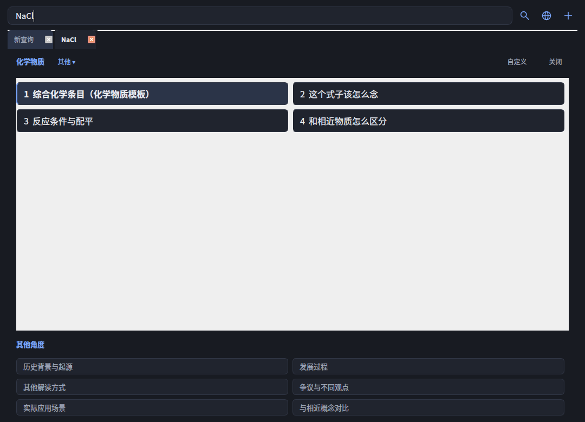
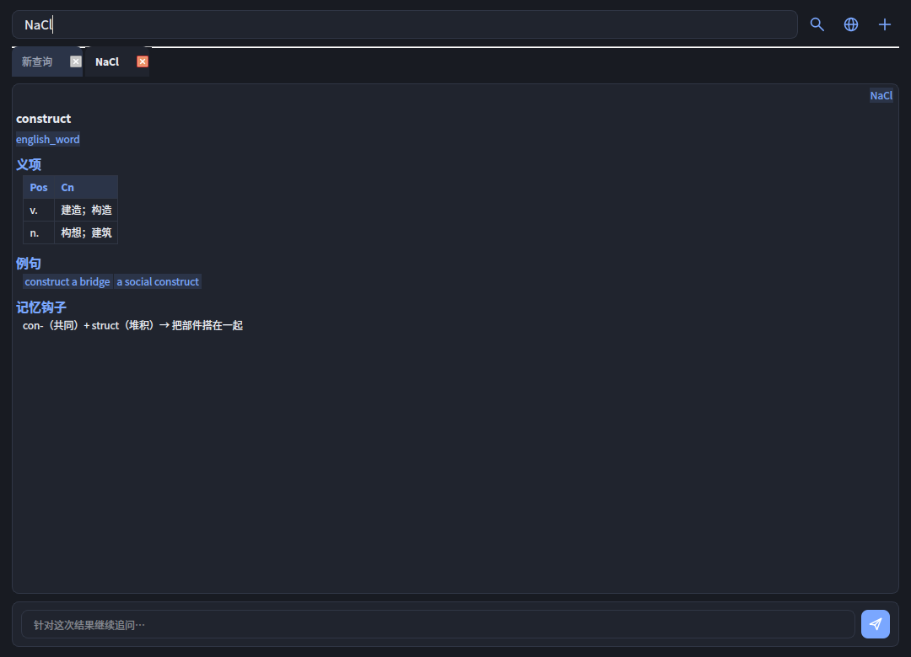
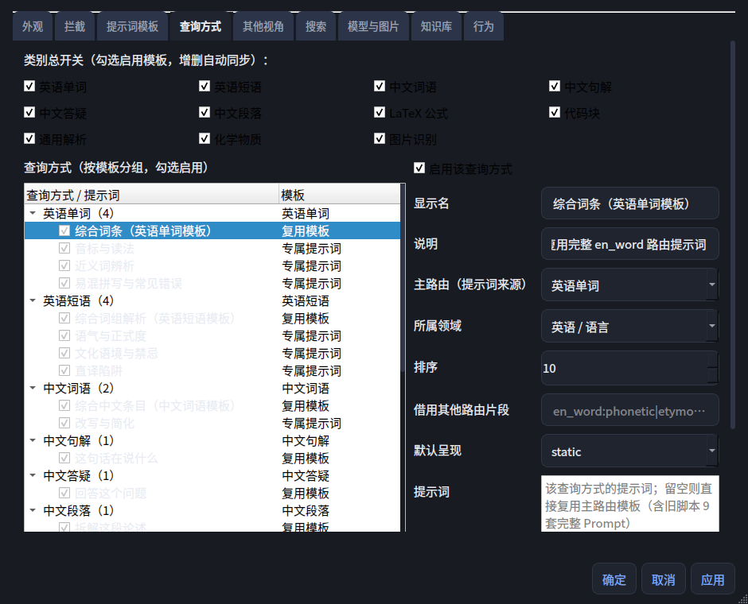

<div align="center">
  
  <h1>clip-llm</h1>
  <p><strong>复制一段内容，先看懂它，再决定让模型解释哪一面。</strong></p>
  <p>本地优先的 Linux 桌面词典式内容解释工具 · 双层界面 · 零 token 初判</p>
  <p>
    <a href="https://github.com/yzbjxh888/clip-llm/releases/latest"></a>
    
    
    <a href="LICENSE"></a>
  </p>
</div>

---

## 一句话理解

你复制文字或图片，`clip-llm` 会先在**本地**判断它大概是什么、列出针对它的几种解释方式；你点哪一种，才把组装好的提示词发给**你自己配置的模型**。结果以结构化卡片呈现，还能继续追问、存成 Markdown 笔记。

> 设计原则：**分类器只缩小选项空间，用户决定解释意图，模型只负责执行。**
> 初判和菜单完全在本地完成、不消耗 token；不填模型配置也能打开软件看界面和本地预览。

---

## 它长什么样

### 1. 第一层：复制后自动初判

复制 `NaCl`、`E=mc²`、英文短语或一段中文，窗口自动弹出。它先给出类别，再把该类别下**全部启用的查询方式**列出来——不是只给一个“问模型”的按钮。

<p align="center">
  
</p>
<p align="center"><em>复制 <code>NaCl</code> 后：化学物质类别 + 4 条专属查询方式 + 其他解读角度</em></p>

### 2. 第二层：结构化结果与追问

选一种解释方式后才请求模型。返回的 JSON / Markdown 会被渲染成表格、列表、定义卡片和公式；结果页底部可以直接追问，上下文自动带上。

<p align="center">
  
</p>
<p align="center"><em>同一标签页内从初判切到结果，不另开窗口；追问仍在这张卡片下方继续</em></p>

### 3. 设置：一切都可插拔

提示词模板、查询方式、其他视角、拦截规则、搜索源、快捷键、主题、知识库目录都在设置里。改完保存，已打开的标签会就地刷新。

<p align="center">
  
</p>
<p align="center"><em>查询方式按模板分组；每条都能改名、改提示词、换主路由、改领域、排序、启停</em></p>

---

## 为什么值得试试

| | 传统做法 | clip-llm |
|---|---|---|
| 初判 | 每次都把原文丢给模型问“这是什么” | 本地特征 + 规则先判，**零网络、零 token** |
| 解释角度 | 一个通用提示词，答案千篇一律 | 11 套模板 / 41 条查询方式，按类别给你不同切面 |
| 选择权 | 模型决定怎么答 | 你先看初判，再点想要的那一种 |
| 结果 | 一坨 Markdown / 纯文本 | 结构化卡片、公式、表格、追问气泡 |
| 后续 | 复制粘贴到笔记软件 | 一次会话直接落成带 YAML frontmatter 的 Markdown |
| 模型 | 绑定某家服务 | 任意 OpenAI 兼容接口；文本与视觉可分别配置 |

---

## 主要功能

- **本地初判**：34 个具名字符特征、7 个领域候选、14 条 `BLOCK / ALLOW` 策略，全部本地计算。
- **双层界面**：一个主窗口、一个标签页里完成“初判 → 结果 → 追问”，`Esc` 一层层返回。
- **可插拔提示词**：11 套模板；9 套注入旧脚本完整提示词；每条查询方式可自带 JSON 字段清单。
- **多轮追问**：结果页底部直接问，自动带上一轮问答作为上下文。
- **结果排版**：JSON / Markdown 双通道，LaTeX 转 Unicode，表格、列表、气泡、深浅主题、字号可调。
- **知识库**：一次会话写成一篇 Markdown（`session` / `rounds` / `created` / `updated`），默认按模板分文件夹，给 Obsidian / Logseq 建图谱用。
- **结果缓存**：磁盘缓存键覆盖提示词、意图、呈现、规则集与输入摘要；改字体/主题不必重新请求。
- **图片识别**：剪贴板图片 / 系统截图 → 视觉模型 → 识别结果回灌初判，`Ctrl+Alt+S`。
- **网页搜索**：7 个出厂搜索源，顶栏与结果页选中文本右键都能用，可增删改。
- **键盘友好**：10 组快捷键全部可在设置里改，冲突保存时拦截。

---

## 快速开始

### 方式一：下载 `.deb`（推荐）

从 [Releases](https://github.com/yzbjxh888/clip-llm/releases/latest) 下载 `clipllm02_0.2.28_amd64.deb`：

```bash
sudo dpkg -i clipllm02_0.2.28_amd64.deb
clipllm02-doctor          # 解释器 / 导入 / 依赖自检
clipllm02-desktop         # 启动
```

包内自带最小 venv（仅 `PySide6-Essentials`），源码在 `/opt/clipllm02/src`，启动器用 `PYTHONPATH` 指过去，不依赖 editable 安装记录。

校验值（可选）：

```text
SHA256 a8482edabab5209c0726360e0fcef2db5af0333d3ba6de57c6dff0a569bc9f73
```

### 方式二：从源码

需要 Python ≥ 3.10；桌面界面需要 `PySide6-Essentials >= 6.8`。

```bash
git clone git@github.com:yzbjxh888/clip-llm.git
cd clip-llm
bash scripts/setup.sh                 # 重建最小 venv + 跑回归测试
.venv/bin/clipllm02-desktop           # 启动
```

打包与快照：

```bash
bash scripts/backup.sh      # 不含 venv 的源码快照（dist/）
bash scripts/build_deb.sh   # 生成 dist/clipllm02_0.2.28_amd64.deb
```

---

## 配置模型：不绑定 Gemini

启动后按 `F3` 打开「模型与图片」页，填写三项：**API 地址、API Key、模型名称**。软件只要求 OpenAI 兼容的 `/chat/completions` 接口，**不绑定任何厂商**。

- 如果 Gemini 高峰期不可用，换成任何兼容端点与 Key 即可，**无需改代码、无需重装**。
- 视觉模型可单独填；留空则复用文本模型的地址与 Key。
- 任一项留空都不会发送网络请求，第二层只显示本地查询预览——可以放心先体验界面。

配置存放位置：

| 位置 | 用途 |
|---|---|
| `~/.config/clip-llm02/settings.json` | 用户配置（含 API Key，只在本机） |
| `~/.cache/clip-llm02/results.json` | 结果缓存 |
| 设置页「知识库」中指定的目录 | Markdown 笔记 |

安装包与仓库**不含任何 API Key**：出厂配置里没有这些字段，打包脚本会扫描源码，发现疑似密钥就中止构建。

---

## 常用快捷键

| 键 | 作用 |
|---|---|
| `Esc` | 结果页返回初判；初判页关闭窗口 |
| `Alt+Left` | 从结果返回初判 |
| `Ctrl+T` / `Ctrl+W` | 新标签 / 关闭标签 |
| `Ctrl+Tab` | 切换标签 |
| `Ctrl+R` | 重新查询 |
| `Ctrl+I` | 独立输入框（中文输入走独立进程） |
| `Ctrl+Alt+S` | 图片 / 截图识别 |
| `Ctrl+Shift+G` | 网页搜索 |
| `F3` | 设置 |

全部可在「设置 → 行为」里修改，冲突会在保存时拦下。

---

## 隐私

- 不上传遥测、不写远端日志；只有你主动选了查询方式，才会请求你自己配置的模型接口。
- API Key 只存在本机 `~/.config/clip-llm02/settings.json`，既不进仓库也不进 `.deb`。
- 知识库笔记与结果缓存都写在本机指定目录；分享机器前请自行清理 `~/.config` 与 `~/.cache`。

---

## 当前边界（如实说）

这个项目仍在打磨，下面几点先讲清楚，免得你踩坑：

- 类别初判仍是 `classify.py` 里的有序规则表 + veto，不是数据驱动条件树；改规则需要改代码。
- 领域候选分数来自出厂常量，尚未做证据加权校准；`physics` 目前没有独立模板。
- `dedup` / `quota` 在部分入口尚未统一接线；拦截记录目前主要在 classic 链路完整落盘。
- 本地图片文件选择入口还没做；视觉输入目前是剪贴板图片与系统截图。`interactive` / `annotate` 仍是标记位，没有专用渲染分支。
- `docs/` 是规格先行产物，个别章节描述的是目标而非现状；`docs/07_DECISIONS.md` 记录了哪些设计已被取代。

详细决策见 [docs/07_DECISIONS.md](docs/07_DECISIONS.md)，图片链路见 [docs/11_IMAGE_PIPELINE.md](docs/11_IMAGE_PIPELINE.md)。

---

## 开发与测试

```bash
PYTHONPATH=src .venv/bin/python -m unittest discover -s tests   # 370+ 用例
.venv/bin/clipllm02-desktop --offscreen --smoke "NaCl"          # 无显示器冒烟
.venv/bin/clipllm02-desktop --doctor                            # 环境诊断
```

核心库（`models` / `features` / `policy` / `settings` / `prompts`）不依赖 Qt，可以单独用标准库跑。诊断开关 `CLIPLLM_DIAG=1` 会在终端打印链路日志。

项目结构：

```text
├── spec/                     出厂配置（settings / policy / intents / search providers / JSON Schema）
│   └── legacy_assets.json    0.1 旧脚本迁移来的 9 套完整提示词
├── src/clipllm02/
│   ├── models.py             不可变数据对象
│   ├── features.py           字符特征注册表 + 条件树求值
│   ├── classify.py           类别初判规则
│   ├── policy.py             两级拦截引擎
│   ├── suggest.py            领域候选与菜单构建
│   ├── prompts.py            提示词组合、输出契约、追问自由作答
│   ├── settings.py           配置深合并 / 校验 / 结构签名
│   ├── json_render.py        JSON / Markdown → Qt Rich Text
│   ├── desktop/              窗口基座、网关、缓存、classic 兼容层
│   └── studio/               统一桌面应用（默认入口）
├── docs/                     规格与设计决策（01–11）
├── assets/screenshots/       README 使用的真实界面截图
├── scripts/                  setup / backup / build_deb
└── tests/                    370+ 单元测试
```

---

## 许可证

[MIT](LICENSE)。欢迎 issue 与 PR；这是一个仍在打磨中的个人项目，接口与配置结构可能随版本调整。
