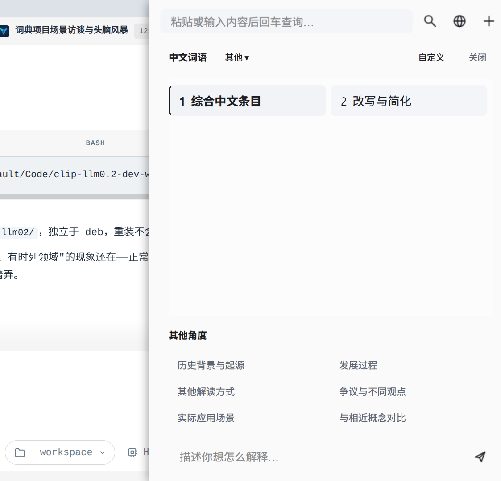
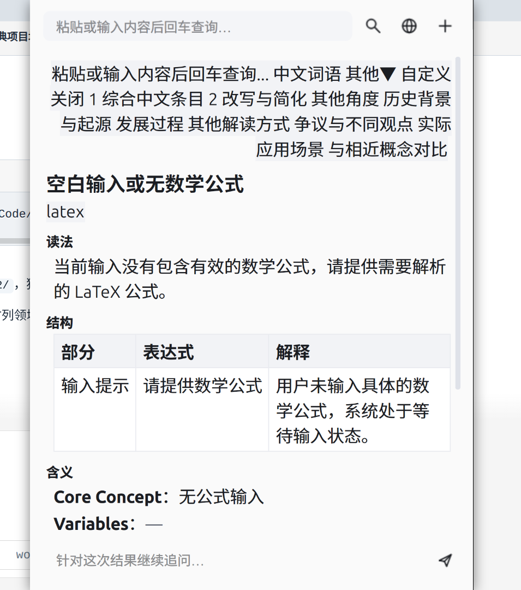
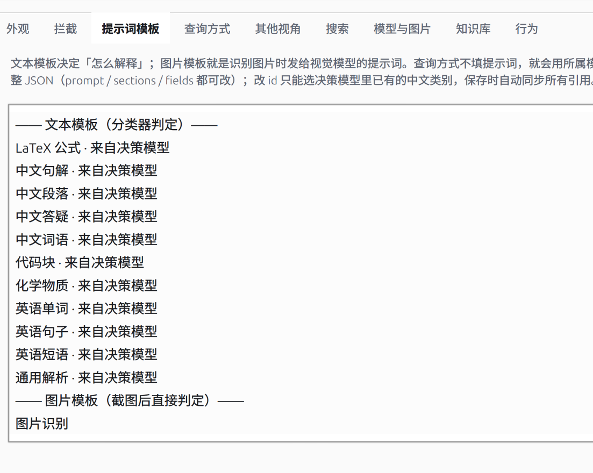
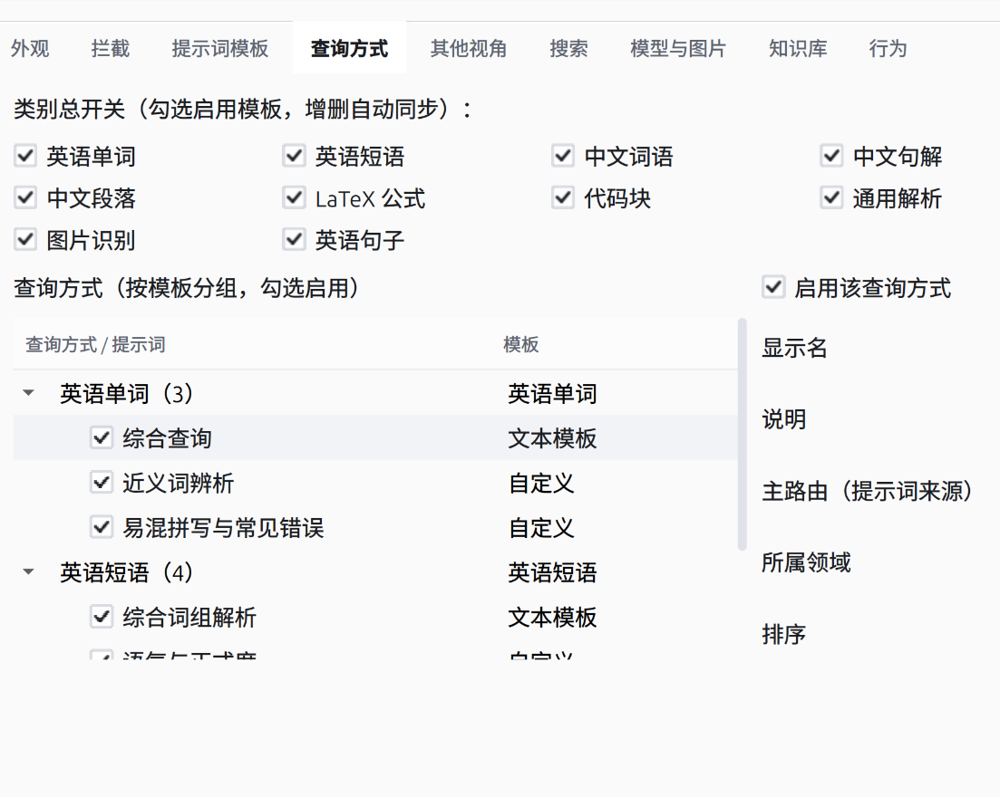
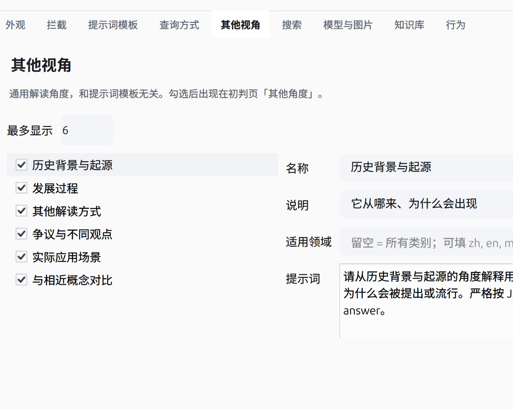

<div align="center">
  
  <h1>clip-llm</h1>
  <p><strong>复制一段内容，先看懂它是什么，再决定让 AI 从哪个角度解释。</strong></p>
  <p>一个装在你电脑上的「智能词典」· 决策模型帮你认内容 · 本地优先</p>
  <p>
    <a href="https://github.com/yzbjxh888/clip-llm/releases"></a>
    
    
    <a href="LICENSE"></a>
  </p>
</div>

<p align="center">
  
  
</p>
<p align="center"><em>复制一段文字，窗口就弹出来：上面是它认出的类别（如「中文词语」），中间是这个类别下的几种解释方式，底部是通用的「其他角度」</em></p>

---

## 它是干什么的

看到一段英文、一个公式、一段代码或一张截图，你通常会把它整段丢给大模型问一句「这是什么」。这样做有三个毛病：每次都要重新想怎么问、答案角度单一、你想要的信息常常不在里面。

clip-llm 把这个动作拆成三步，让**一个专门的「决策模型」先帮你认内容**：

1. **决策模型认一认**（主角）——你复制内容后，一个擅长做判断的小模型（SystemOne）先看一眼，从你事先定好的类别里挑出最合适的一个，比如「中文词语」「LaTeX 公式」「英语单词」。它只回答"这是哪一类"，不写长文，所以又快又省。
2. **软件摆出菜单**——按认出来的类别，把这个类别下你配好的几种解释方式列出来让你选（比如「中文词语」下面有「综合中文条目」「改写与简化」）。
3. **你选一个，大模型才动手**——只把你点选的那一种角度连同原文发给**你自己配置的**大模型（OpenAI 兼容接口，不绑定厂商）。结果渲染成漂亮的卡片，还能接着追问。

> 一句话：**决策模型负责认出"这是什么"，你负责决定"想看哪一面"，大模型负责"把这一面讲清楚"。**

最关键的一点：**有哪些类别、每个类别怎么解释，都是你自己说了算**。改一处设置，菜单和模板会自动跟着变——后面「决策模型路由」一节会讲清楚。

如果你一项模型配置都没填，软件照样能打开，界面和本地判断都能体验，只是不会真的联网。

---

## 快速开始

### 安装

从 [Releases](https://github.com/yzbjxh888/clip-llm/releases) 下载对应版本的 `.deb`（以发布页实际提供的版本为准）：

```bash
sudo dpkg -i clipllm02_0.2.45_amd64.deb
clipllm02-doctor          # 自检：解释器 / 包导入 / PySide6 / 环境
clipllm02-desktop         # 启动
```

包内自带最小虚拟环境（仅 `PySide6-Essentials`），源码位于 `/opt/clipllm02/src`，不依赖 editable 安装记录。校验值随 Release 一同发布。

### 从源码运行

需要 Python ≥ 3.10；桌面界面需要 `PySide6-Essentials >= 6.8`。

```bash
git clone https://github.com/yzbjxh888/clip-llm.git
cd clip-llm
bash scripts/setup.sh                 # 重建最小 venv + 跑回归测试
.venv/bin/clipllm02-desktop           # 启动
```

### 第一次使用：配置模型

1. 启动软件，按 `F3` 打开**设置**窗口。
2. 切到「**模型与图片**」页，填写三项：**API 地址、API Key、模型名称**。
3. 决策模型（SystemOne）由环境变量 `AGNES_API_KEY` 提供密钥；有哪些类别、怎么判别，在「**拦截**」页的那个 JSON 里改（开箱自带 11 个类别，一般不用动）。

保存后即可使用。任一项留空都不会发送网络请求——这是刻意设计的，方便你先体验界面。配置只写入本机 `~/.config/clip-llm02/settings.json`，**仓库和安装包都不含任何密钥**。

---

## 决策模型路由：这个软件的核心

这一节讲清楚"决策模型怎么认内容、菜单怎么来"。理解了它，设置页就都会用了。

### 类别清单：改一个地方，处处生效

在「设置 → 拦截」页，有这样一个 JSON 框——它是整个软件的**类别清单**，也是唯一需要你维护的地方：

<p align="center">
  
</p>
<p align="center"><em>第一行 <code>_instructions</code> 告诉决策模型"怎么判"；下面每行「类别名:判别描述」定义一个类别</em></p>

- **改判别指令**：改第一行引号里的文字，就能改变决策模型按什么标准判断。
- **加一个类别**：加一行 `"新类别": "什么内容算这一类"`，软件会自动生成同名的提示词模板和查询方式。
- **删一个类别**：删掉那一行，对应的模板也会连带删除。
- **改判别标准**：只改某一行的描述，不改变这类内容的模板文案。

里面有个「通用解析」类别是兜底用的（其他都归类不了时选它），别删。JSON 写错了只会提示、不会保存，所以放心改。改完点「保存并派生模板」，再点右下角「确定」才真正存盘。

决策模型拿到你复制的内容后，就是照着这张清单挑一个最匹配的类别；软件再按这个类别把对应的解释方式摆到初判页上。**这条链是单向的**：清单是源头，模板和查询方式都是从它派生出来的，所以在模板页改 id 只能选清单里已有的类别。

### 本地规则：不联网的省钱备选（次要）

默认由决策模型来认内容。如果你不想让它联网判断，也可以在设置里切到**本地规则**：用正则匹配内容特征来粗判类别。它不发网络请求、不花 token、断网也能用，但accuracy 不如决策模型，属于次要备选。

两者是互斥的，任一时刻只有一个生效。另外按设计，决策模型调用失败时（比如网络不通），软件会明确提示你手动选类别，**不会偷偷退回本地规则**——这样你总能知道这次判断到底来自哪里。

---

## 怎么用

### 1. 复制内容 → 看决策模型认出什么

复制文字或图片，窗口会自动弹出（软件同时监听剪贴板变化）。最上面那行类别标签（如「中文词语」「化学物质」）就是决策模型刚判出来的结果，接着列出这个类别下**全部启用的解释方式**：

- **类别判错了？** 点「其他 ▾」手动换一个，只重建菜单、不发请求。
- **想不联网？** 到设置里切成本地规则（上一节说的次要备选）。
- 解释方式带数字序号，但**不是数字键快捷键**；用鼠标点，或方向键配合回车。
- 点「自定义」会展开一个输入框，可以直接写你想要的解释要求。
- 底部「其他角度」最多 6 条通用视角（历史背景、争议、应用场景等），跟类别无关，一直都在。
- 命中硬拦截规则（密钥、超长、URL 等）时**完全静默**——不弹窗、不发请求。

### 2. 选一种方式 → 看结构化结果

点选后在同一标签页内切换到结果层，不另开窗口：

<p align="center">
  
</p>
<p align="center"><em>返回内容渲染成表格、定义、列表与公式；底部输入框可直接接着问</em></p>

- 返回内容会解析成字段表、列表、定义卡片与公式（LaTeX 转 Unicode）。
- 结果下方输入框回车即可**追问**，上下文自动带上，在同一张卡片里追加问答。
- 在结果上选中文本右键，可直接复制、用默认搜索引擎搜索，或用选中文本开一个新标签查询。

### 3. 图片与截图

- **复制图片**：直接复制截图或图片到剪贴板，软件会单独监听并弹出初判。默认超过 **2 MB** 的图片不自动弹窗（可在设置里调整，`0` 表示不限制）。
- **系统截图**：按 `Ctrl+Alt+S` 进入区域截图，识别后先出菜单。**识别结果默认不会自动续跑文本初判**，由你决定下一步。
- 图片识别支持四种内置方式：OCR 提取、表格识别、图片理解、原图标注。
- 图片与文本同时出现时按「图片优先」处理；同一次复制的图片/文本双通道会互相抑制，避免重复弹窗。

### 4. 设置：一切都可改

按 `F3` 打开设置窗口，共 9 个页签：

`外观 → 拦截 → 提示词模板 → 查询方式 → 其他视角 → 搜索 → 模型与图片 → 知识库 → 行为`

下面挑几个常用的页签，对照截图说明。

#### 提示词模板页：每种内容用什么提示词解释

<p align="center">
  
</p>
<p align="center"><em>文本模板决定「怎么解释」，可改完整 JSON；标「来自决策模型」的模板，就是上一节类别清单自动派生出来的</em></p>

模板分两组：**文本模板**（决策模型判定类别后使用）和**图片模板**（截图识别时发给视觉模型）。改 id 只能选决策模型里已有的中文类别，保存时自动同步所有引用。

#### 查询方式页：每个类别下面挂哪些解释角度

<p align="center">
  
</p>
<p align="center"><em>查询方式按模板分组：勾选启停，可改显示名、说明、主路由（提示词来源）、所属领域、排序</em></p>

「类别总开关」控制哪些模板启用；下方每个模板组里是它旗下的查询方式（如「英语单词」下有综合查询、近义词辨析、易混拼写等）。右侧详情面板编辑选中项的字段。

#### 其他视角页：不管什么类别都能用的角度

<p align="center">
  
</p>
<p align="center"><em>其他视角跟提示词模板无关，勾选后出现在初判页的「其他角度」，数量上限可调</em></p>

出厂 6 条（历史背景与起源、发展过程、其他解读方式、争议与不同观点、实际应用场景、与相近概念对比），每条可改名称、说明、适用领域、提示词。

#### 知识库页：把结果存成本地笔记

<p align="center">
  
</p>
<p align="center"><em>结果按「库根/分类/日期_标题.md」存成 Markdown，可用 Obsidian / Logseq 打开；分类文件夹和笔记数一目了然</em></p>

可设置知识库目录、开关保存、刷新与整理旧分类。自定义查询归「通用」，追问追加到同日笔记。

---

改完保存，已打开的标签会就地刷新，保持当前处于初判页还是结果页。快捷键冲突会在保存时拦下。

### 5. 存成笔记

一次会话可写成一篇带 YAML frontmatter 的 Markdown（`session` / `rounds` / `created` / `updated`），默认按模板分文件夹，适合 Obsidian / Logseq 建图谱。

---

## 主要功能

| 功能 | 说明 |
|---|---|
| 决策模型路由（核心） | SystemOne 认内容、选类别；类别清单是唯一事实源，模板与查询方式自动派生 |
| 本地规则（备选） | 正则特征粗判，不联网、零 token，准确度较低，与决策模型互斥 |
| 解释方式菜单 | 按类别列出 41 条查询方式、11 套提示词模板，每条都能改 |
| 结构化结果 | JSON / Markdown 渲染成表格、列表、定义卡、公式，深浅主题与字号可调 |
| 多轮追问 | 结果页底部直接问，自动带上历史上下文 |
| 双层界面 | 一个主窗口、一个标签页内完成「初判 → 结果 → 追问」 |
| 图片识别 | 剪贴板图片 / 系统截图 → 视觉模型；四条内置图片方式 |
| 网页搜索 | 7 个出厂搜索源，顶栏与结果页选中文本右键都能用，可增删改 |
| 知识库 | 一次会话一篇 Markdown，本地目录自定 |
| 结果缓存 | 缓存键覆盖提示词、意图、呈现、规则集与输入摘要；改字体/主题无需重新请求 |
| 键盘友好 | 10 组快捷键全部可在设置里改 |

### 默认快捷键

| 键 | 作用 |
|---|---|
| `Esc` | 结果页返回初判；初判页隐藏窗口 |
| `Alt+Left` | 从结果返回初判 |
| `Ctrl+T` / `Ctrl+W` | 新标签 / 关闭标签 |
| `Ctrl+Tab` | 切换标签 |
| `Ctrl+R` | 重新查询 |
| `Ctrl+I` | 打开独立输入框（中文输入走独立进程） |
| `Ctrl+Alt+S` | 系统截图识别 |
| `Ctrl+Shift+G` | 网页搜索选中文本 |
| `F3` | 打开设置窗口 |

---

## 命令行

核心库不依赖 Qt，可用标准库直接跑：

```bash
clipllm02 describe "NaCl"              # 输入 → 特征 → 策略 → 领域 → 菜单全链路
clipllm02 menu "E=mc²"                 # 只看初判菜单
clipllm02 compose en_word --show-prompt
clipllm02 validate                     # 校验配置
clipllm02 selftest                     # 运行测试
```

桌面入口：

```bash
clipllm02-desktop --doctor             # 环境诊断
clipllm02-desktop --offscreen --smoke "NaCl"   # 无显示器冒烟
clipllm02-desktop --register-shortcuts # 注册 GNOME 全局截图快捷键
```

也支持 `python -m clipllm02.studio`、`python -m clipllm02.cli`。诊断开关 `CLIPLLM_DIAG=1` 会在终端打印链路日志。

---

## 隐私

- 不上传遥测、不写远端日志；只有你主动选了查询方式，才会请求你自己配置的模型接口。
- API Key 只存在本机 `~/.config/clip-llm02/settings.json` 或环境变量里，既不进仓库也不进 `.deb`；打包脚本会扫描源码，发现疑似密钥就中止构建。
- 结果缓存与知识库笔记都写在本机指定目录；分享机器前请自行清理 `~/.config` 与 `~/.cache`。

---

## 当前边界（如实说）

- 短文本默认走决策模型（需联网、需环境变量 Key）；本地 `classify.py` 仍是有序规则表 + veto，作为次要备选，改规则要改代码。
- 决策模型调用失败时按设计不回退本地规则，而是提示手动选类别。
- 领域候选分数来自出厂常量，尚未做证据加权校准；`physics` 目前没有独立模板。
- `dedup` / `quota` 在部分入口尚未统一接线。
- 本地图片文件选择入口还没做；视觉输入目前是剪贴板图片与系统截图。`interactive` / `annotate` 仍是标记位，没有专用渲染分支。
- `docs/` 是规格先行产物，个别章节描述的是目标而非现状；`docs/07_DECISIONS.md` 记录了哪些设计已被取代。

详见 [docs/07_DECISIONS.md](docs/07_DECISIONS.md) 与 [docs/11_IMAGE_PIPELINE.md](docs/11_IMAGE_PIPELINE.md)。

---

## 开发

```bash
PYTHONPATH=src .venv/bin/python -m pytest -q -p no:cacheprovider   # 813 用例
bash scripts/backup.sh      # 不含 venv 的源码快照（dist/）
bash scripts/build_deb.sh   # 生成 dist/clipllm02_<版本>_amd64.deb
```

```text
├── spec/                     出厂配置（settings / policy / intents / search providers / JSON Schema）
│   └── legacy_assets.json    0.1 旧脚本迁移来的 9 套完整提示词
├── src/clipllm02/
│   ├── models.py             不可变数据对象
│   ├── features.py           字符特征注册表 + 条件树求值
│   ├── classify.py           本地类别初判规则（次要备选）
│   ├── policy.py             拦截引擎
│   ├── suggest.py            领域候选与菜单构建
│   ├── prompts.py            提示词组合、输出契约、追问自由作答
│   ├── settings.py           配置深合并 / 校验 / 结构签名
│   ├── json_render.py        JSON / Markdown → Qt Rich Text
│   ├── desktop/              窗口基座、网关、缓存（与 Studio 共用）
│   └── studio/               统一桌面应用（唯一入口）
├── docs/                     规格与设计决策（01–11）
├── assets/screenshots/       README 使用的真实界面截图（8 张）
├── scripts/                  setup / backup / build_deb
└── tests/                    813 单元测试
```

---

## 许可证

[MIT](LICENSE)。欢迎 issue 与 PR；这是一个仍在打磨中的个人项目，接口与配置结构可能随版本调整。
