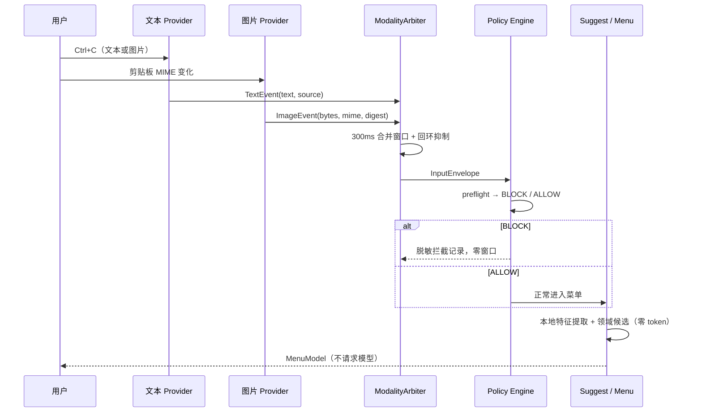

# 0.2 输入、剪贴板、图片识别与拦截策略规格

## 1. 五条输入通道（0.1 实际实现）

| 通道 | Provider | 频率 | 数据 | 主开关 | 去重 | 触发策略 |
|---|---|---|---|---|---|---|
| CLIPBOARD 文本（扩展事件文件） | `EventFileProvider` | 事件驱动 | `text/plain` | ✅ | `_hash_cache` + `duplicate_ttl_seconds` | ✅ |
| CLIPBOARD 文本（轮询兜底） | `PollProvider` | 1.0s | `xclip -o` | ✅ | 同上 + 5s 事件让位 | ✅ |
| PRIMARY 划词 | `primary_provider` | 1.0s | `wl-paste --primary` | ✅ | 同上 | ✅ |
| 图片 MIME | `ImagePollProvider` | 1.2s | `image/png\|jpeg\|webp` | ✅ | `image_digest` + `_primed` | ❌ 独立 |
| 内部续接 | `submit_internal` | 即时 | LaTeX 字符串 | ❌ | 跳过 `note_self_copy` | ❌ |
| 手动 | `submit_manual` | 即时 | 当前剪贴板 | ❌ | 部分 | ❌ |

来源字符串是枚举：`gnome-extension` / `poll` / `primary` / `manual` / `hotkey` /
`screenshot` / `image-followup` / `bridge`。**绝不携带剪贴板原文**。

## 2. 图片与文本管线的关系

### 2.1 0.1 现状

```
图片 → run_image() → 视觉模型 → LaTeX
     → _copy_to_clipboard(latex) + note_self_copy()
     → submit_internal(latex, source="image-followup")
     → ClipboardManager._dispatch → DesktopApp._start_query
     → 普通文本分类 → 文本模型 → 解释卡片
```

- 图片**不走分类器**，是独立 MIME 通道（`core/image.py:1-5`）；
- 视觉模型输出只有 LaTeX 一种（`DEFAULT_IMAGE_PROMPT`），不支持"理解图片/提取表格/标注"；
- 写回剪贴板后靠 `note_self_copy()` 抑制文本 Provider 回环，续接走内部通道不依赖
  Wayland 剪贴板事件；
- 主开关、去重、防抖、`trigger_policy` 都被 `submit_internal` 跳过，但每日限额保留。

### 2.2 0.2 目标

保留上链路作为**快捷预设**（用户按 `Ctrl+Alt+S` 本身就是一次主动选择），
同时把图片提升为一等输入模态：

- `InputEnvelope.assets` 保留原图，OCR/LaTeX 只作为 `derived`；
- 用户选择"原图标注""理解图片内容"等意图时，把**原图**直接发给视觉模型；
- 原图存 `AssetStore`，数据对象只放 `asset_id / mime / sha256 / local_path / w / h`，
  **绝不把 base64 塞进跨层对象**；
- 快捷预设与意图菜单并存，由 `image.quick_preset_enabled` 开关。

> 0.2.7 起（ADR-15）：图片先出「图片查询方式」菜单，用户选定模板后才调视觉
> 模型；剪贴板/截图不再自动识别，总开关为 `image.vision_enabled`。图 + 文
> 同时存在时 `modality=mixed`，图片由视觉模板消费、文本由文本模板消费。

### 2.3 三个真实竞态

1. **同一次复制同时提供文本与图片**（网页里复制带 alt 的图、富文本编辑器）：
   两条 Provider 在 ~1s 窗口内都触发 → 同时弹文本菜单和图片识别。
2. **软件自己把 LaTeX 写回剪贴板**：文本 Provider 会看到新文本，靠
   `note_self_copy()` 抑制；`image_auto_recognize` 开着时图片 Provider 也会
   重新看到旧图，靠 `_last_digest` 抑制。
3. **登录后剪贴板残留上次的图**：`ImagePollProvider._primed` 专门防止启动瞬间
   把旧图上传（`clipboard/providers.py:70-91`）。

### 2.4 ModalityArbiter

位于 `_handle` / `_handle_image` 之前，300ms 合并窗口：

```python
@dataclass(frozen=True)
class InputEnvelope:
    envelope_id: str
    modality: str                    # text | image | mixed
    text: str | None
    assets: tuple[AssetRef, ...]
    source: str
    captured_at: float
    derived: dict                    # ocr_text / ocr_blocks / visual_features
                                     # 由「用户选择意图后」才填充
```

| `image_text_conflict` | 行为 |
|---|---|
| `image_only`（默认） | 丢弃同窗口文本事件，`modality=image` |
| `text_only` | 丢弃图片事件，`modality=text` |
| `mixed` | `modality=mixed`，原图与文本一起进请求（适合"解释这个公式，并结合图片中的文字"） |
| `ask` | 菜单同时显示两种预览，由用户选模态 |

冲突处理只影响 `Suggestion.modality`，**不改写 `raw_text`**（0.1 的
`build_context()` 已把 `\n` / `\t` 还原，识别用的 `norm` 与发送给模型的 `text`
必须分开，避免破坏 LaTeX、代码缩进、化学上下标）。

### 2.5 AssetStore

- 路径：`~/.cache/clip-llm/assets/<sha256前2>/<sha256>.<ext>`；
- 大小上限 `image_max_bytes`（默认 8 MiB）、TTL `asset_ttl_days`（默认 7 天）、
  LRU 清理；
- 写入用原子写（临时文件 + `os.replace`），目录权限 `0700`；
- `asset_id` 与 `sha256` 相同，重复图片不重复落盘；
- 退出时**不立即删除**，避免"换一种解释"时原图丢失。

## 3. 图片侧拦截与判别

| 检查 | 判别方式 | 0.1 位置 | 失败行为 |
|---|---|---|---|
| MIME 白名单 | `IMAGE_MIMES=("image/png","image/jpeg","image/webp")`；先 `wl-paste --list-types` / `xclip -t TARGETS` 轻量探测 | `core/image.py:23,41-71` | 返回 None，不触发 |
| 文件头 | PNG `\x89PNG`、JPEG `\xff\xd8`；0.2 补 webP `RIFF....WEBP` | `core/image.py:85-91` | 跳过该 MIME |
| 大小 | `len(data) > image_max_bytes` | `core/image.py:86` | 跳过，设置页可调 |
| 重复 | `image_digest()` 与 `_last_digest` 比对 | `providers.py:83-91` | 不触发 |
| 启动残留 | `_primed`：第一次 tick 只记录不触发 | `providers.py:70-80` | 不触发 |
| 自动上传授权 | `image_auto_recognize`（默认关闭） | `manager.py:113-116` | Provider 不启动 |
| 受限页面（Chrome 桥接） | `RESTRICTED_SCHEMES`（chrome://、about:、data:、javascript:…） | `background.js:18-21` | ⛔ 徽标 |
| 裁剪合法性 | 最小边长 4px；按「实际宽高 / 视口宽高」反推缩放，不信任 DPR | `background.js:426-448` | 取消 |
| 截图内容隐私 | 截图可能含 API Key / 邮箱 → 本地预览后询问 | 0.2 新增 | `CONFIRM` |

**"用户选择前不请求模型"在图片上的边界（必须写死）**：

- 手动 `Ctrl+Alt+S` / 托盘「识别图片」= 用户主动选择 → 允许直接调视觉模型；
- `image_auto_recognize=true` 属于被动触发 → 在 `trigger_policy=menu` 下**强制禁用**，
  设置页保存时直接拒绝并提示；
- `image_text_conflict=ask` 时用户选模态也不算选择意图，仍要再选一次意图。

## 4. 硬拦截清单：分级 + 判别特征

> **本节已被 ADR-13 取代（2026-11-16）**：0.2.7 起只保留 `BLOCK` / `ALLOW`
> 两级，硬拦截收敛为闭集且禁止引用语义特征。下面的 WARN / CONFIRM 表仅作
> 历史参考，现行清单见 `spec/builtin_policy.json` 与 ADR-13。

### 4.1 分级语义

`preflight(envelope, settings) -> PolicyResult(level, reason, evidence)`

| 级别 | 界面行为 | 是否产生请求 |
|---|---|---|
| `BLOCK` | 无窗口、无通知，只写脱敏记录 | ❌ |
| `WARN` | 菜单正常出现，判定条下多一行黄色提示；提交即视为授权 | ✅（用户提交后） |
| `CONFIRM` | 先弹一次明确授权确认，未授权不继续 | ✅（授权后） |
| `ALLOW` | 无提示 | ✅ |

`Policy Engine` 必须**独立于 `Classifier`**：改一条拦截级别不触碰分类规则与
0.1 的 135 条分类回归用例。拦截记录字段：
`ts / level / reason / source / text_len / modality`，**不含原文、URL 全文、
API Key、内容 hash**。

### 4.2 完整清单

| # | 内容 | 判别特征 / 正则 | 默认级别 | 设置键 | 可关闭 |
|---|---|---|---|---|---|
| 1 | 空 / 纯空白 | `ctx.text == ""` | BLOCK | 固定 | ❌ |
| 2 | URL | `URL_RE = ^(https?\|ftp\|file)://\S+$` | WARN | `policy.url.level` | ✅ |
| 3 | 邮箱 | `EMAIL_RE = ^[\w.+-]+@[\w-]+(\.[\w-]+)+$` | WARN | `policy.email.level` | ✅ |
| 4 | 盘符路径 | `DRIVE_RE = ^[A-Za-z]:[\\/]` | WARN | `policy.path.level` | ✅ |
| 5 | POSIX / 反斜杠路径 | `PATH_RE` + 含 `/`；`BACKSLASH_PATH_RE` | WARN | `policy.path.level` | ✅ |
| 6 | 文件名 | `feature("filename")`：无空格/引号、后缀在 `lexicon.json` 或 mime 可猜、排除缩写与强代码符号 | WARN | `policy.filename.level` | ✅ |
| 7 | 疑似密钥/口令 | `SECRET_HINT_RE`（password / private key / api_key / otpauth / 6 位验证码…）+ `sensitive_patterns`；**多行代码豁免** | CONFIRM | `policy.secret.level` | ✅ |
| 8 | 绝对长度 | `ctx.letters > code_block_max`（默认 1000 字母） | BLOCK | `thresholds.code_block_max` | 阈值可调 |
| 9 | 伪词 | `FAKE_WORD_RE = ^(.)\1{3,}$ \| ^[^aeiouy]{13,}$` | WARN | `policy.fake_word.level` | ✅ |
| 10 | 英文整句 | `EN_SENTENCE_RE = ^[A-Za-z]+(?: [A-Za-z]+)+[.?!]$` | **不拦截** | `rules.english_sentence.enabled=false` | ✅ |
| 11 | 英文单词过长 | `letters > word_max_len`(15) | WARN | `thresholds.word_max_len` | ✅ |
| 12 | 英文短语过长 | `len(words) > phrase_max_words`(5) | WARN | `thresholds.phrase_max_words` | ✅ |
| 13 | 中文各类过长 | `cn_pure_max / cn_mixed_max / cn_sentence_max / cn_question_max / cn_paragraph_max` | WARN | `thresholds.*` | ✅ |
| 14 | 代码/通用过长 | `code_max`(80) / `code_block_max`(1000) | BLOCK | `thresholds.*` | 阈值可调 |
| 15 | 重复内容 | `_hash_cache` + `duplicate_ttl_seconds`(300) | 跳过 | `duplicate_ttl_seconds` | ✅ |
| 16 | 每日限额 | `requests_today >= daily_request_limit`(300) | BLOCK | `daily_request_limit` | 阈值可调 |
| 17 | 路由/意图被禁用 | `disabled_route_action=hide_from_menu` | 菜单不显示 | `disabled_route_action` | ✅ |

求值顺序：`BLOCK` 项优先短路 → 收集所有 `WARN` 的 evidence → `CONFIRM` 单列 →
`ALLOW`。若同时命中 BLOCK 与 WARN，只报 BLOCK（但诊断页保留完整 evidence 列表）。

### 4.3 判别特征总表（FEATURES 目录）

`settings.validate()` 会校验规则里引用的特征名必须存在；设置页"输入与拦截"
列出这张表作为只读说明。

| 类别 | 特征名 | 计算方式 |
|---|---|---|
| 长度/语言 | `letters` `cn_count` `en_count` `word_count` `is_multiline` `has_cn` `has_en` `cn_dominant` | 字符计数；`cn_dominant` 用 `cn_dominant_min`(6) 且 `cn>=en` |
| 词形 | `is_word` `is_phrase` `en_sentence` `fake_word` `camel` | `WORD_RE` / `PHRASE_RE` / `EN_SENTENCE_RE` / `FAKE_WORD_RE` / `CAMELCASE_RE` |
| 中文结构 | `cn_question` `cn_sent_route` `cn_para_route` `cn_nl_route` `cn_sentence` | 句末标点 + 长度阈值 + 学术引注 `[n]` 剥离 + 代码让位 |
| LaTeX | `latex_signal` | `\begin{}` / `\(...\)` / `$...$` 内含 `=^_{}+\-` / `\command`；排除价格与 `$PATH` |
| 代码 | `code_block` `multiline_code_sym` `strong_sym` `code_like` `is_cli` `filename` | 多行缩进、关键字词表、`shutil.which()` 判断真实命令、SQL/模板特征 |
| 隐私（L1 常量，非 FEATURES） | `URL_RE` `EMAIL_RE` `PATH_RE` `DRIVE_RE` `BACKSLASH_PATH_RE` `SECRET_HINT_RE` | 正则直判 |

### 4.4 领域判定与内容特征必须分离

`NaCl` 同时是"拉丁字符组合"（特征）与"化学 / 标识符"（候选领域）；
`E=mc²` 同时有数学表达式特征与物理内容。**不得因为含数学运算符就排除物理**。

`DomainResolver` 非短路地求值所有已启用规则，产出
`(domain_id, score, evidence)` 候选集；`score` 是启发式评分，**明确不是概率**，
阈值放在 `settings.detection` 且可用测试集校准：

```json
{
  "detection": {
    "high": 0.80, "mid": 0.50, "gap": 0.15,
    "mixed_min_score": 0.80, "max_candidates": 3,
    "score_mode": "heuristic"
  }
}
```

| 档 | 判定条件 |
|---|---|
| HIGH | `top.score >= high` 且 `top.score - second.score >= gap` |
| MIXED | ≥2 个候选 `score >= mixed_min_score` |
| MID | `top.score >= mid` |
| LOW | 其余（含全部为 0） |

LOW 时不下判断，交用户选领域——"严格判定"的正确含义是**证据不足时拒绝强制判断**。

---

## 5. 附：Mermaid 输入仲裁时序


