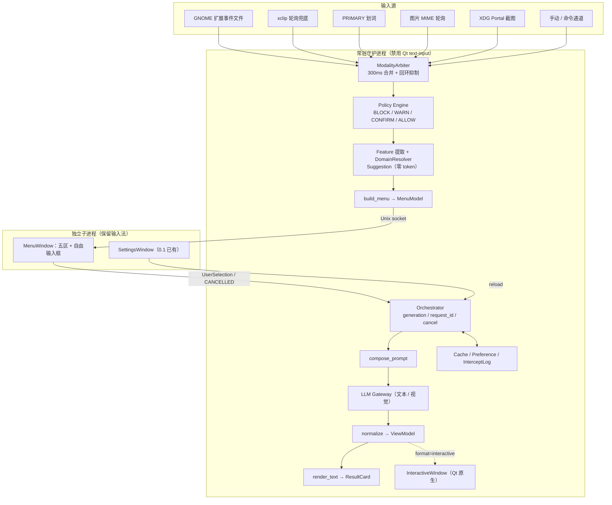
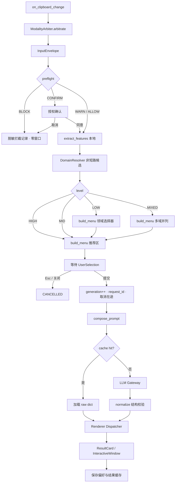
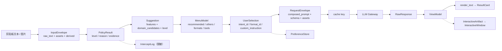
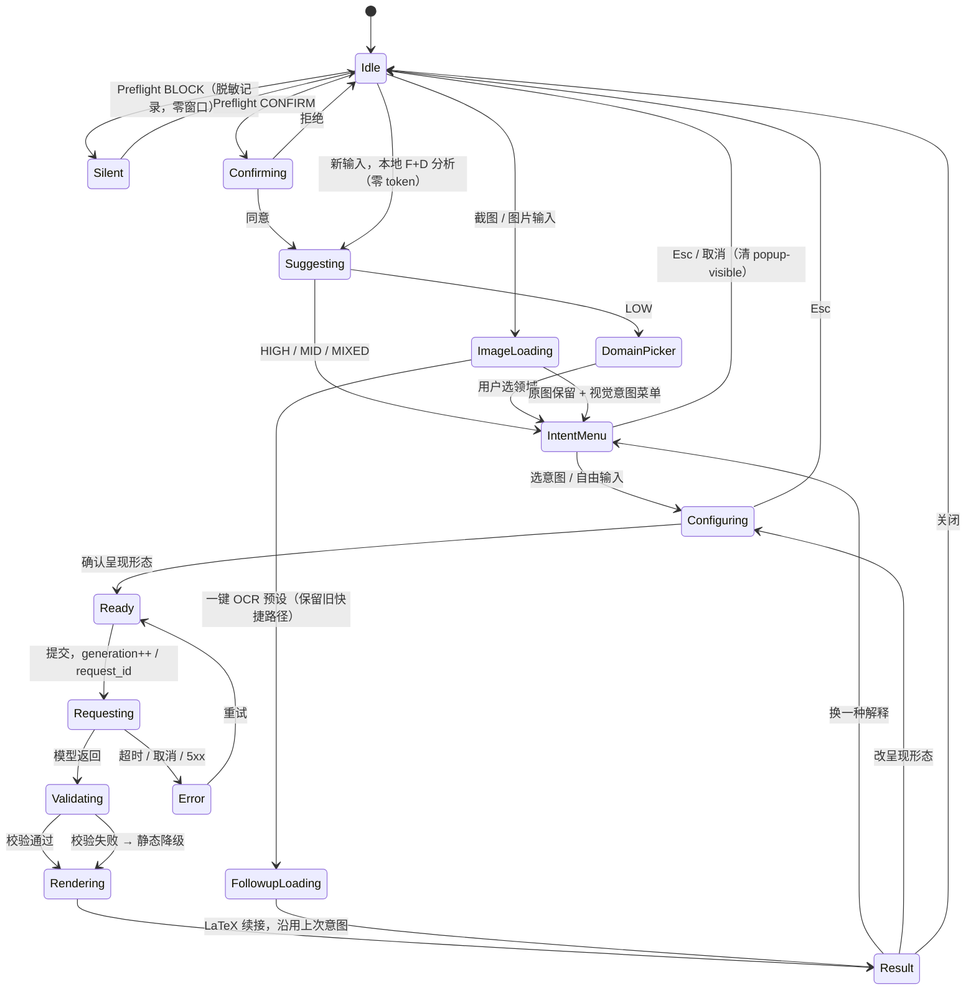

# 0.2 目标架构

## 1. 五个维度（唯一命名）

| 维度 | 回答什么 | 0.2 模块 | 0.1 对应 | 权威 |
|---|---|---|---|---|
| **M 输入模态** | 给的是文本/图片/混合 | `modality.py` | `clipboard/providers.py`、`core/image.py` | 用户操作 |
| **F 内容特征** | 语言/粒度/符号/结构 | `features.py` | `core/features.py` 的 `FEATURES` | 本地规则 |
| **D 领域** | 大概属于哪个知识领域 | `suggest.py::DomainResolver` | 混在 `rules.json` 的 `route_id` 里 | 只给候选，**非权威** |
| **I 解释意图** | 想看它的哪一面 | `intents` 配置 + `prompts.py` | 等价于 `route_id`，与内容类型绑死 | **用户**，权威 |
| **R 呈现形态** | 结果长什么样 | `formats` 配置 + `render_text` / 独立窗口 | 只有静态一种 | 用户，可默认 |

铁律：**F 与 D 绝不选 Prompt；D 只排菜单顺序；I 才决定 Prompt；R 决定渲染器。**

## 2. 分层与进程边界



## 3. 控制流



关键点：

1. **菜单阶段零模型请求**：`F` 与 `D` 全是本地规则；只有 `UserSelection` 提交后
   才允许进入 `compose_prompt` → `GW`。
2. **只有一条查询入口**：所有来源最终走 `ClipboardManager._dispatch()` →
   `on_query` → `DesktopApp._start_query()`，图片续接不另开入口
   （0.1 `docs/interaction.md` 的不变量）。
3. **`generation` 在提交时递增**，菜单阶段不递增；过期结果直接丢弃。
4. **模型输出与呈现分离**：模型出内容或声明式 Spec，本地 Renderer 决定怎么展示。

## 4. 数据流



缓存键：

```text
key = sha256(
    sha256(composed_prompt)
  + composition_hash          # sorted(includes)
  + model + model_params
  + route_id + intent_id
  + format_id + schema_version
  + custom_instruction + style_ref
  + ruleset_version
  + query_hash                 # 文本 hash 或 image_digest
)
```

三条不变量（0.1 已有，0.2 继承）：

- 分类/领域决策**不缓存**；
- 只缓存解析后的 raw 结构化数据，**不缓存 HTML**；
- 错误结果不缓存；强制刷新绕过缓存。

偏好单独存轻量表，TTL 与结果缓存解耦——改提示词时不应把用户习惯也清掉。

## 5. 状态机



`popup-visible` 只在确实展示了菜单/卡片/loading 时置位；拦截、静默、关闭后必须清除。
图片识别的中间状态允许单独取消、重新处理，不能和模型请求状态混在一起。

## 6. 模块契约表

| 模块 | 输入 | 输出 | 是否允许调模型 |
|---|---|---|---|
| `ModalityArbiter` | TextEvent / ImageEvent | `InputEnvelope` | ❌ |
| `PolicyEngine` | `InputEnvelope` + settings | `PolicyResult` | ❌ |
| `FeatureExtractor` | `InputEnvelope` | `FeatureSet` | ❌ |
| `DomainResolver` | `FeatureSet` + rules | `Suggestion` | ❌ |
| `MenuBuilder` | `Suggestion` + intents + prefs | `MenuModel` | ❌ |
| `MenuWindow` | `MenuModel` | `UserSelection` / `CANCELLED` | ❌ |
| `PromptComposer` | `UserSelection` + RoutePacks | `RequestEnvelope` | ❌ |
| `LLMGateway` | `RequestEnvelope` | `RawResponse` | ✅ 唯一 |
| `Validator` | `RawResponse` | `ViewModel` / `InteractiveArtifact` | ❌ |
| `RendererDispatcher` | `ViewModel` | 可见内容 | ❌ |
| `CacheManager` | key / raw dict | raw dict | ❌ |
| `PreferenceStore` | 用户选择 | 排序权重 | ❌ |

**唯一允许调用模型的模块是 `LLMGateway`**。插件不得自行决定请求发送、缓存写入
和界面状态，否则可插拔会退化成难以控制的耦合。

## 7. 与 0.1 的关系

| 0.1 能力 | 0.2 处理 |
|---|---|
| `RouteRegistry` / `routes.d/` 五文件 | 原样保留，新增 `kind` / includes 引用 |
| `FEATURES` 具名特征注册表 | 原样保留，导出 `feature_catalog()` 供设置页 |
| `rules.json` 声明式条件树 | 原样保留，`DomainResolver` 以非短路方式复用 `evaluate_condition` |
| `Decision(action, route_id)` | 原样保留（`auto` 模式），`menu` 模式由 `UserSelection` 覆盖 |
| `ViewModel` 唯一渲染契约 | 原样保留，交互 Spec 走旁路不替换 `render_text` |
| `ResultCache.make_key` | 扩展字段，旧键格式不变 |
| `generation` / 取消 / 拦截静默 | 原样保留 |
| Wayland 剪贴板三层 Provider | 原样保留，前面插入 `ModalityArbiter` |
| 图片 → LaTeX → 续接 | 保留为快捷预设，另加一等图片意图 |
| 9 条 `SYSTEM_PROMPT_*` | 原样保留为 `composite` 预设包 |
| 77 个测试 + 135 条分类用例 | 全部保留为回归基线 |
