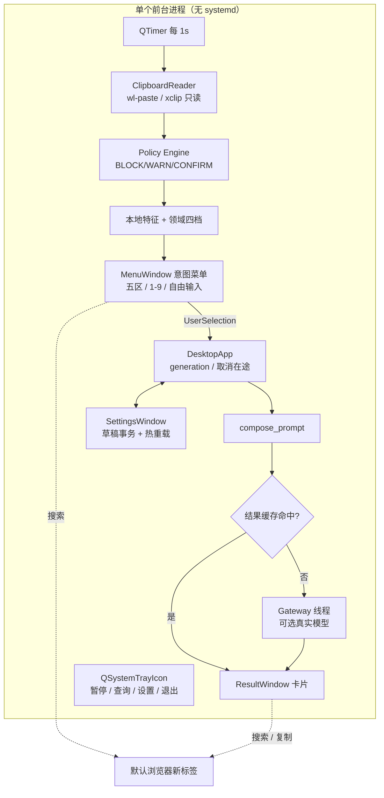

# 0.2 桌面版规格与能力对照（classic 兼容层）

> **注意**：`clipllm02-desktop` 已改为统一的双层 Studio 应用，
> 规格见 `docs/09_STUDIO.md`。本文件描述的是 `clipllm02-classic` 兼容入口
> （菜单弹窗 + 结果弹窗两个独立窗口）与 `desktop/` 基座，不再是默认路径。

## 1. 结论

**能做成和 0.1 一样的桌面软件，且已经跑起来了**：托盘常驻、剪贴板触发、置顶弹窗、
右键菜单、设置窗口、模型调用、结果缓存、搜索跳转都可用。
但它不是 0.1 的复制——核心交互换成了 0.2 的**用户意图菜单**，并且明确
**不注册 systemd**，只以前台进程运行。

- 源码：`src/clipllm02/desktop/`
- 启动：`.venv/bin/clipllm02-desktop`（或 `python -m clipllm02.desktop`）
- 依赖：PySide6（可选依赖 `[desktop]`），已装入 0.2 的 `.venv`
- 0.1 源码目录保持不动

## 2. 运行

```bash
cd clipllm02

# 正常启动（Wayland 桌面，前台进程）
.venv/bin/clipllm02-desktop

# 无托盘环境 / 自定义轮询间隔 / 无界面自测
.venv/bin/clipllm02-desktop --no-tray
.venv/bin/clipllm02-desktop --interval 0.5
.venv/bin/clipllm02-desktop --offscreen --no-tray --smoke "NaCl"
```

`Ctrl+C` 优雅退出；`SIGINT` 已注册处理函数。没有 service 文件、没有
`systemctl enable/start`、没有 `Restart=on-failure`。

**默认不发网络请求**：设置 → 模型里 API URL / Key / 模型名三者留空任一项时，
选择意图后只显示「本地请求预览」（组装好的 prompt、字段、缓存键），
明确标注未发送网络请求。填齐后才走 OpenAI 兼容 `/chat/completions`。

配置与缓存路径（XDG）：

| 用途 | 路径 |
|---|---|
| 用户配置 | `~/.config/clip-llm02/settings.json` |
| 结果缓存 | `~/.cache/clip-llm02/results.json` |
| 出厂配置 | `spec/*.json`（不写盘） |

## 3. 进程结构



要点：

- **只有一条入口**：所有来源（剪贴板轮询、托盘手动查询、smoke）都走
  `DesktopApp.process_text()`；
- `generation` 在新输入、取消、提交时递增，过期模型结果直接丢弃；
- 模型调用放工作线程，通过 `QObject` 信号回主线程渲染，不阻塞 UI；
- 自己把结果写进剪贴板会登记抑制哈希，不会被监听当成新复制；
- 设置保存后 `load_settings()` 热重载，重建 Gateway 与菜单配置，不重启进程。

## 4. 与 0.1 的能力对照

| 能力 | 0.1 | 0.2 桌面版 | 说明 |
|---|---|---|---|
| 托盘常驻 | ✔ | ✔ | 无系统托盘时自动跳过并继续运行 |
| 剪贴板文本监听 | 扩展事件 + xclip 轮询 + PRIMARY | wl-paste/xclip 轮询 + 去重 + 自我复制抑制 | 0.2 未接 GNOME 扩展事件通道 |
| PRIMARY 划词 | ✔ | ✘ | 可后续补 Provider |
| 弹窗 | 结果卡片 | **意图菜单 + 结果卡片** | 0.2 的核心差异 |
| 自动分类 → 自动查询 | ✔ | ✘ | 改为「程序给候选、用户选意图」 |
| 四档领域 / 换领域 / 自由输入 | ✘ | ✔ | HIGH/MID/LOW/MIXED |
| 呈现形态 | 静态 HTML | 静态/表格/交互/标注（元数据） | 交互渲染器尚未接入 |
| 只读卡片渲染 | `QTextBrowser` + ViewModel + KaTeX/MathML | `QTextBrowser` + 任意 JSON/文本渲染 | 均不用 QWebEngineView |
| 模型调用 | Gemini 兼容、重试、503 降级 | 可选 OpenAI 兼容 + 超时/取消 | 0.2 重试策略较简单 |
| 结果缓存 | SQLite WAL 365 天 / 5 万条 | JSON 文件 500 条 LRU | 键都含 prompt/意图/格式/规则集版本 |
| 设置窗口 | 8 页签、独立进程、草稿事务 | 5 页签、草稿事务、热重载 | 0.2 未拆独立进程 |
| 可插拔 | `routes.d/` + `rules.json` | 意图/领域/拦截/搜索源均可在设置页开关 | 例如关闭英语查询、关闭词组查询 |
| 搜索跳转 | 单模板右键 | 多 provider 下拉 + 右键子菜单 | `QDesktopServices.openUrl` |
| 右键 / 快捷键 | 7 项能力 | 搜索、换解释、重新查询、复制、设置、关闭；1-9 / F3 / Esc / Ctrl+R | 窗口内快捷键 |
| 图片识别 | Portal 截图 + 视觉模型 + LaTeX 续接 | 规格已定义，桌面版未接入 | 见 `02_INPUT_POLICY_SPEC.md` |
| 交互图表 | ✘ | 格式可选，渲染器未接入 | 见 `03_MENU_INTENT_SPEC.md` |
| 窗口缩放 / 拖拽 / 边缘命中 | ✔ | 简化（固定尺寸，可 resize 代码层） | 未做边缘转发 |
| 置顶 | Shell 扩展 `make_above()` | **pinned（默认）**：新查询 `_NET_WM_STATE_ABOVE` 置顶 400ms 后自动解除（提前解除 = 点其它窗口零迟滞）；unpinned：静态 `WindowStaysOnTopHint`，让位靠 `hide()` | `_NET_RESTACK_WINDOW` 在 Mutter 下被焦点保护拒绝，已弃用 |
| Alt+Tab 可见 | — | pinned 用 `Qt.Window`（默认常驻）；unpinned 用 `Qt.Tool`，隐藏时不在列表 | classic 仍用 Tool 弹窗；切换需重启 |
| 全局快捷键 | gsettings media-keys | 窗口内快捷键 | 未写 gsettings |
| 输入法隔离 | 常驻进程禁用 text-input + 独立设置进程 | 普通 Qt 应用，中文输入可用 | 未做 0.1 那套隔离，长期驻留需观察 fcitx5 |
| 每日限额 / 拦截日志持久化 | ✔ | 拦截记录内存保存 | 未落盘、未做配额 |
| systemd | 可选 unit | **明确不注册** | 前台进程，Ctrl+C 退出 |

## 5. 已验证

```
QT_QPA_PLATFORM=offscreen python -m unittest discover -s tests -v
→ Ran 109 tests OK

timeout -s INT 3 .venv/bin/clipllm02-desktop --no-tray --interval 5
→ 真实 Wayland 下前台启动并优雅退出

offscreen 完整链路：E=mc² → MIXED 菜单 → 选「分析随参数怎么变」
→ 结果卡片「本地请求预览」→ stats events=1 menus=1 selections=1 requests=1
```

测试覆盖：五区控件、选择/自由输入信号、四档领域、LOW 领域选择器、
设置草稿取消与原子写盘、结果缓存持久化与淘汰、自我复制抑制、
generation 防乱序、拦截零弹窗、任意模型响应渲染。

## 6. 已知限制与下一步

| 优先级 | 待办 | 对应文档 |
|---|---|---|
| P1 | 图片输入接入桌面版（剪贴板图片 / Portal 截图 / 视觉意图菜单） | `02_INPUT_POLICY_SPEC.md` |
| P1 | 交互 Spec 校验器 + Qt 原生图表独立窗口 | `03_MENU_INTENT_SPEC.md` |
| P2 | 接 GNOME 扩展事件通道、PRIMARY 划词、全局快捷键 | `06_MIGRATION_PLAN.md` |
| P2 | 窗口缩放/拖拽/边缘转发、独立设置进程的输入法隔离 | `01_UI_SPEC.md` |
| P3 | 每日限额、拦截日志落盘、模型重试与 503 降级、SQLite 缓存 | `04_SETTINGS_SPEC.md` |
| P3 | 0.1 的 9 套完整 `SYSTEM_PROMPT_*` 导入 `spec/` | `06_MIGRATION_PLAN.md` |

**没有 systemd 的代价**：进程随终端关闭而退出，没有开机自启、没有崩溃自动重启。
这是用户明确要求；如需长期驻留，建议用终端复用器或桌面会话的「启动应用程序」
（仍不是 systemd）。

---

## 7. 修复记录（六条用户反馈）

| # | 反馈 | 根因 | 修复 |
|---|---|---|---|
| 1 | 抢焦点、不流畅、窗口不可调、无窗口记忆 | `mousePressEvent` 里 `activateWindow()`；每次 `raise_()`；完全没有几何逻辑 | 新增 `window_base.py`：`WA_ShowWithoutActivating` + `show_without_focus()`（不 activate、不 raise）、`QSettings` 记忆 size/pos、边缘 14px 缩放、右下角 grip、顶部 34px / Alt 拖动、子控件事件转发、右键「重置窗口」 |
| 2 | 界面杂乱、交互巨大卡顿 | `subprocess.run(wl-paste)` 同步跑在 UI 线程；`_clear_layout` 用 `deleteLater()` 反复重建几十个控件；五区全展开、置灰项/搜索源/参考风格全塞进界面 | 剪贴板轮询移入 `QThread`（`clipboard_worker.py`），UI 线程只收信号；`menu_window.py` 改为**控件只创建一次、`_render()` 只改文本/可见性**；去掉 QGroupBox 堆叠，次要信息默认折叠，样式表单次设置 |
| 3 | 初判后应该用领域常用查询类型，而不是同一模板 | 所有意图共用路由 `prompt.md`；`"*"` 通用意图无条件混进推荐区 | `builtin_intents.json` 重写为 28 条领域专属意图（化学/英语单词/习语/中文/数学/物理/代码/图片），每条带 `prompt_override` 专属提示词；`build_menu` 推荐区只放当前领域专属意图，通用兜底仅在无专属意图时出现 |
| 4 | 有时复制后不弹窗、新查询不覆盖旧弹窗 | `ClipboardReader` 只选一个命令，`wl-paste` 失败不回退 `xclip`；去重哈希无时间窗且被自我复制污染；旧控件延迟删除导致视觉残留 | `commands()` 返回所有可用命令并逐个尝试；`_seen` 去重带 300s TTL、自我复制单独 `_self_copy` 集合；每次新输入清 `state.selection`、强制 `update_model()`、`show_without_focus()`，并隐藏旧结果卡片 |
| 5 | 初判应自动，但要有选项 | LOW 档直接返回空推荐区，强制用户先选领域 | LOW 也自动出菜单（通用兜底 + 各领域代表意图），领域 chip / 换领域下拉 / 自由输入 / 更多选项始终保留 |
| 6 | 有操作后闪退 | 访问 `deleteLater()` 已删除控件；`_on_worker_done` 失败分支在 `state.selection=None` 时抛异常；工作线程退出后仍 emit；SIGINT 处理器直接调 Qt API；析构期 emit `cancelled` | 控件复用不再销毁；所有槽函数 `try/except` 落到 `app.errors`；失败分支防御空状态；`_alive` 标志阻止迟到信号；`shutdown()` 停止线程并断开信号；SIGINT 只置标志、由 QTimer 在事件循环里退出；菜单 `closeEvent` 不再 emit |

### 附带修复

- **陈旧用户配置**：旧 `settings.json` 里存着 22 条老意图，导致新版菜单不生效。
  现在用 `intents_version`（当前 3）在启动时只刷新 `intents` 段，
  用户改过的模型、开关、拦截级别、搜索源全部保留。
- **Wayland text-input 焦点噪音**：默认保留中文输入法并抑制 Qt 的无害
  `disableSurface` 警告；新增 `--isolate-text-input` 走 0.1 式严格隔离
  （零警告、最流畅，但内联输入框不支持中文输入法）。
- **剪贴板读取**：`commands()` 逐个尝试 `wl-paste` / `xclip`，任一成功即返回。

### 验证

```
Ran 129 tests — OK（含 test_desktop_fixes.py 六类问题回归）
timeout -s INT 3 clipllm02-desktop --interval 1                 → 真实 Wayland 无警告
timeout -s INT 3 clipllm02-desktop --isolate-text-input ...     → 真实 Wayland 无警告
NaCl      → 它是什么物质 / 这个式子该怎么念 / 在什么条件下会反应 / 和相近物质怎么区分
E=mc²     → 逐项读这个式子 / 把它推出来 / 参数变化时图象怎么变 / 量纲与适用条件
break the ice → 这个习语到底什么意思 / 字面画面和出处
12345     → LOW 档自动出「通用解释」+ 全部领域选项
```
