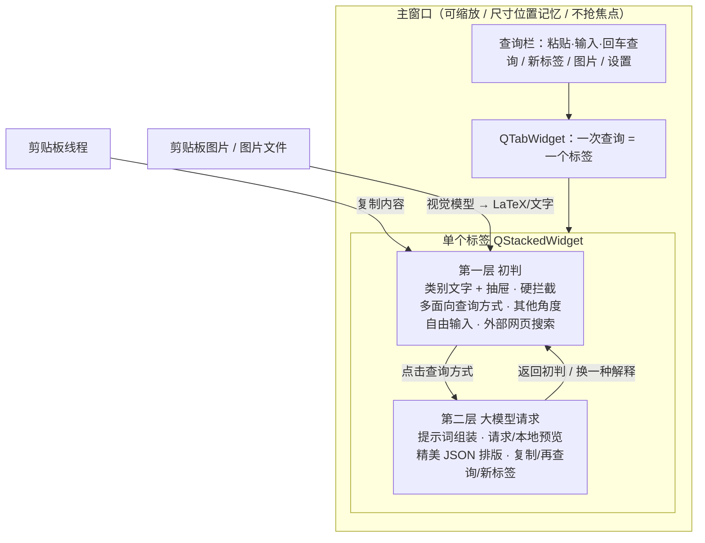
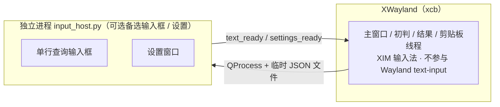

# Studio：统一的两层词典式应用

这是 0.2 的**默认桌面应用**（`clipllm02-desktop`）。它替代了之前"菜单弹窗 +
结果弹窗"两个独立小窗口的补丁式设计，改为**一个主窗口、一个标签页内两次切换**。

- 源码：`src/clipllm02/studio/`
- 入口：`python -m clipllm02.studio` / `clipllm02-desktop`
- 兼容入口：`clipllm02-classic`（旧弹窗版本，不再是默认路径）
- 前台进程，**不注册 systemd**

## 1. 两层 UI



### 第一层：初判

- **类别初判（自动识别意图）**：`classify.py` 复用 `gd_llm.py` 的三层结构
  （L0 归一化 → L2 特征 → L3 有序规则表 + veto），按内容特征判定**最可能的
  类别**。类别就是「提示词模板」页的条目（`settings.routes`），
  增删模板自动成为可选类别，不硬编码清单。
  初判层用**一行文字 + 一个抽屉标签**呈现：标题只写判定出的类别名（不再
  重复「常用查询方式」、不再报条数），抽屉是「其他 ▾」，自由输入是
  「自定义」；不并列铺开、不画边框、不重复展示输入内容预览卡片。
  点击抽屉里的类别只重建菜单、不发请求。「常用查询方式」与第二层一一对应：
  该模板下启用的查询方式**全部列出**（超出一屏可滚动，不再被裁掉），首位固定
  为该模板的综合条目（提示词留空、复用模板的那条），其余严格按设置里的排序；
  不混入其它模板；
  「其他角度」来自第三层「其他视角」的**通用角度条目**（不是模板类别），
  自由输入保留。
  设置里改查询方式名 / 提示词 / 启停，保存后已打开的标签原地刷新菜单。
  有历史偏好时用户习惯优先；菜单阶段零模型请求。
  排查初判不准可用 `CLIPLLM_DIAG=1` 或 `classify.explain_text()`。
- **依据放宽的旧分类器规则**：`features.py` 的 30+ 具名特征 +
  `policy.py` 的 `BLOCK/ALLOW` 两级硬拦截。旧脚本里那些"英文单词 > 15 字"
  "中文 > 20 字"之类的软长度规则不再拦截、也不弹提示——因为用户现在有自由输入、
  其他领域推荐、
  换领域三条退路，判错没有代价。中文长度按术语 20 / 句子 120 / 疑问 120 /
  段落 600 四类分别判定，不再共用一条闸门；`fake_word` 只匹配 ASCII。
- **自动完成，但选项始终在**：HIGH 直接给该领域菜单；MID 带"可能不准"提示；
  MIXED 并列多领域；LOW 也直接出菜单（通用兜底 + 各领域代表意图），
  不再强制"先选领域再出第二步"。
- **查询方式只保留模板未覆盖的侧面**：① 的字段（读法 / 结构 / 含义 /
  推导 / 行为 / 应用）不再各自拆成一条查询方式——那是把同一份内容问两遍，
  既重复又费 token。新增条目必须提供 ① 之外的角度（量纲、等价变形、
  数值算例、直观类比、推广、辨析、实验依据…）。审计后出厂意图从 74 条
  精简为 41 条，单面向类别（中文句解 / 答疑 / 段落、通用解释、图片表格 /
  标注）改为直接复用完整模板。
- **每条查询方式自带 JSON 字段清单**：② 的提示词里写清「只输出这些字段」
  以及每个字段的结构（字符串 / 数组 / 每项有哪些键），不再依赖契约的
  字段名列表。系统契约只负责三件事：要求单个合法 JSON、固定
  `query_type`、重申反斜杠必须双写（`\psi` 写成 `\\psi`）。
  这样既不会冒出模板之外的自造字段，也不会因为 `\Σ`、`\ψ` 这类非法
  转义让整条结果解析失败、退化成原始文本。
  有专属清单时，契约第 3 条改为「以上方列出的字段清单为准」，不再重复
  罗列模板字段，避免两套清单互相矛盾。
- **同一模板下的多面向查询方式**（设置里改几条，界面就显示几条）：
  | 输入 | 领域 | 第一层给出的选项 |
  |---|---|---|
  | `NaCl` | 化学物质 | 综合化学条目 / 这个式子该怎么念 / 反应条件与配平 / 和相近物质怎么区分 |
  | `E=mc²` | LaTeX 公式 | 综合公式解析 / 逐项读这个式子 / 把它推出来 / 量纲与适用条件 …（共 10 条） |
  | `break the ice` | 英语短语 | 综合词组解析 / 语气与正式度 / 文化语境与禁忌 / 直译陷阱 |
  | `construct` | 英语单词 | 音标与读法 / 常见义项有哪些 / 词根词缀怎么来的 / 常和哪些词一起用 |
  | `print("hello")` | 编程 | 这段代码在做什么 / 边界条件与异常 |
  | 中文句子 | 中文 | 这个词怎么判定 / 这句话在说什么 / 拆解这段论述 |
  | 截图 | 图像 | 提取图片中的文字 / 识别公式并解释 / 提取表格 / 这张图在讲什么 / 原图标出关键处 |
- 每条选项带自己的 `prompt_override`（设置里可改），推荐区只放当前领域专属项，
  通用兜底只在该领域无专属项时出现。
- **其他领域推荐**、**自由输入**（描述需求 / 直接写提示词）、
  **外部网页搜索**（多搜索源）都在同一层。

### 第二层：大模型请求

点击任一查询方式后切换到结果页：

1. `build_request_prompt()` 组装提示词（意图专属 prompt + 片段引用 +
   append-only 输出契约）；
2. 配置了模型就请求 OpenAI 兼容端点；**没配置 Key 则只显示本地预览**，
   明确标注未发送网络请求；
3. 返回内容交给 `json_render.py`：`QTextBrowser` 只支持 Qt Rich Text 子集，
   因此样式一律内联到 `p` / `span` / `td`（`border-radius`、
   `display:inline-block`、div padding 等浏览器 CSS 不会被保留）；
   JSON / Markdown 双通道，容忍模型在 JSON 前后附加说明文字，
    `list[dict]` 自动转表格、标量列表转标签、字段标题中文化，
   浅色/深色主题与字号可配，HTML 全部转义（不执行模型返回的 HTML/JS）。
   **公式全局渲染**：所有出口（JSON 字段、Markdown、纯文本、图片识别转写）
   统一把四种定界符转成「Unicode 符号化 + 数学斜体」的公式样式：
   行内 `$...$` 与 `\(...\)`（旧提示词写法）同行渲染，
   独立 `$$...$$` 与 `\[...\]` 单独成段并**居中**。
   上下标（`10^{-34}` → `10⁻³⁴`）、希腊字母、分式、根号、矩阵均可读，
   不再原样显示美元符号。Qt 会忽略 `span` 的 `text-align`，所以独立公式
   落在 `<p align='center'>` 上（`QTextDocument` 实测 `AlignHCenter`）；
   公式里的 `\begin{pmatrix}` 不再被误判成代码块。

   **只渲染像公式的内容**：含 LaTeX 命令或数学运算符才转换，
   `价格 $5 与 $10`、`$3.14$` 这类金额 / 纯数值保持原样，
   输入预览同样不会剥掉它们的 `$`。模型把公式写成 `` `$x$` `` 时，
   反引号会被剥掉后再渲染，不会被包成代码样式。

   视觉提示词与本渲染器对齐：行内 `$...$`、独立 `$$...$$`，
   并明确要求不要用反引号 / 代码块 / `\(...\)` 包裹。
   结果缓存只存模型原始文本，命中时按当前字号与主题现场渲染；缓存键含
   `RENDER_SCHEMA`，渲染器升级后旧条目自动失效；
4. 结果页可复制、可换一种解释、可把选中文字再查询、可在新标签打开。
5. **对话式结果 + 多轮追问**：结果页是累积的对话，不是单条替换——
   每轮以「右对齐用户气泡 + 模型卡片」追加，前面几轮可回看对照；
   新一轮输入（`set_context`）才清空。追问时底部输入框只把「本次追问」作为
   新的 user 消息，system prompt **原样沿用上一轮**，并把上一轮的
   `user` / `assistant` 作为 `history` 一起发送；追问不读也不写结果缓存
   （缓存键与上一轮相同，命中会回放旧答案）。没有上一轮时退化为普通查询。
   追问不修改 `tab.env`，所以「复制再查询」「返回」仍拿原始输入。
6. **结果页滚动与底部操作**：新查询 / 自定义查询后**从顶部开始**看（提问与
   第一轮结果），追问后停在**本轮追问**处而不是贴底；加载中才跟到最新一条。
   底部只保留一条 20px 的细线——左侧状态文字，右侧「返回 / 复制 / 关闭」
   三个无边框文字链（`QToolButton#textAction`），不再是一整条导航栏。
   分节标题去掉了整行底色，改为蓝色粗体小标题，长结果不会连成灰块。
7. **知识库落盘**（`studio/library.py`）与「知识库」页签：结果为
   `<库根>/<分类>/日期_标题.md`，分类取「① 提示词模板」的中文名，
   自由输入落在「通用」。库根默认 `~/.local/share/clip-llm02/library`，
   可在 **设置 → 知识库** 自定义、直接打开目录、查看现有分类与篇数。
   页签里的「整理旧分类」会把旧版本用英文 id 建出的目录（如
   `chem_substance`）并到中文分类，同名笔记不覆盖。
8. **落盘细节**：每次成功返回都写一篇 Markdown，
   目录与提示词模板同名、文件名 `日期_标题.md`，同名直接覆盖。
   每篇带 YAML frontmatter（`query` / `template` / `intent` / `followup` /
   `created`），正文由 JSON 转 Markdown（`list[dict]` → 表格，
   标量数组 → 列表，嵌套对象 → 小节）。写盘失败只记录，不影响展示。

## 2. 词典式交互

| 行为 | 实现 |
|---|---|
| 新查询覆盖旧查询 | 复制内容或查询栏回车 → 当前标签回到第一层并刷新（默认）；窗口同时直接提到前面显示，**无需点击系统通知** |
| 在新标签页打开新查询 | 「在新标签打开 ⧉」/ `Ctrl+T` / 设置里可设为「总在新标签」 |
| 在查询页复制进行查询 | 「复制内容再查询」取选中文本或整条内容 → 立即作为新查询 |
| 关闭标签 | 标签页 × 或 `Ctrl+W`，至少保留一个 |
| 查询栏 | 可直接粘贴/输入内容回车查询，不必等剪贴板 |
| 焦点防护 | 自动弹出打上 `WindowDoesNotAcceptFocus`，绝不从 Chrome / 输入法抢键盘焦点；用户点击内容区才解除并激活（XWayland 下串扰的最后一块补丁） |
| Esc 关闭初判 | 第二层先返回初判；第一层隐藏主窗口（剪贴板监听继续，下次复制再显示）。窗口未激活时由 X11 全局键位图兜底触发，不必先点窗口；若焦点在原生 Wayland 窗口（XWayland 看不到按键），点击窗口一次后仍走原有 Qt 快捷键 |
| 不抢焦点 | `WA_ShowWithoutActivating` + `show_without_focus()`，不 activate/raise |
| 窗口双模式（对齐 GoldenDict `pinButton`） | **默认固定窗口（pinned）**：普通 `Qt.Window` 常驻、出现在 Alt+Tab；新查询置顶 **0.4 秒后自动解除**，窗口仍停在栈顶、视觉不动，之后点其它窗口由 WM 立刻盖住（零迟滞），窗口不关闭，**只有 Esc 退出**；鼠标进入保持置顶、离开立即解除。取消勾选 = GoldenDict 式取词弹窗：`Qt.Tool` 静态置顶、移开 0.4 秒自动隐藏（隐藏时 Alt+Tab 找不到）。窗口类型构造时决定，切换需重启 |
| 窗口可调 | 边缘 14px 缩放、右下角 grip、顶部/Alt 拖动、`QSettings` 记忆尺寸位置；**Wayland 用 `QWindow.startSystemResize/startSystemMove` 交给合成器**，修复拖左/上边缘时客户端 `setGeometry` 被忽略 x/y 导致的方向反向 |

## 3. 三份资产如何融合

| 资产 | 融合方式 |
|---|---|
| `gd_llm.py` / clip-llm 分类器 | L0 归一化、L1 硬否决、L2 特征、L3 规则 → `features.py` + `policy.py`；规则**放宽**：长度类改为 notices 提示（不拦截、不弹窗）、英文整句不再拦截、URL/邮箱/路径可查询，因为已有自由交互与其他领域兜底 |
| `gd_llm.py` 的 9 套 `SYSTEM_PROMPT_*` | 连同 17 条规则、135 个用例的词表抽成 `spec/legacy_assets.json`（21,224 字），启动时注入到对应路由模板（出厂共 11 套模板）；设置里可逐条编辑 |
| Chrome Math OCR 扩展 | `vision.py` 沿用 `image_url` + `data:image/png;base64,...`、45s 超时、代码围栏清理；支持剪贴板图片与本地图片文件；识别结果作为新的查询内容进入第一层，不另开 UI |
| clip-llm 桌面能力 | 剪贴板轮询线程、去重/自我复制抑制、结果缓存、generation 防乱序、设置草稿事务、XDG 配置路径全部复用 `desktop/` 基座 |
| clip-llm 的 `normalize`/渲染哲学 | `json_render.py` 对任意响应都产出完整卡片：合法 JSON / 缺字段 / 纯文本 / 非法 JSON / 空响应都不炸 |

## 4. 设置

`设置` 按钮或 `F3` 打开，草稿事务（取消整体丢弃、确定/应用才校验写盘热重载）。
页签顺序固定为：**外观 → 拦截 → ① 提示词模板 → ② 查询方式 → ③ 其他视角 →
搜索 → 模型与图片 → 行为**，与初判页「先选类别、再选方式、最后换视角」的顺序一致：

| 页签 | 可调整 |
|---|---|
| 外观 | 结果卡片字号（9–28pt）、深色主题 |
| 拦截 | 14 条策略，仅 BLOCK / ALLOW 两级（勾选＝拦截，取消勾选＝放行） |
| **① 提示词模板** | 旧脚本 9 套完整路由模板逐条编辑（核心层与桌面端共用全文）；新增模板可选用脚本全文作起点；增删模板时类别总开关自动同步；**图像识别视觉提示词** |
| **② 查询方式** | 顶部类别总开关（数量 = 模板数）；下方**按提示词模板分组的查询方式树**，顶层数量恒等于模板数量。每条可勾选启用、改显示名 / 说明 / 所属领域 / 主路由 / 排序 / 默认呈现 / **专属提示词** / 借用片段，并可「在当前模板下新增」「删除自定义」 |
| **③ 其他视角** | 与提示词模板无关的**通用解读角度**（历史背景与起源、发展过程、其他解读方式、争议与不同观点、实际应用场景、与相近概念对比），可增删、改名称/说明/提示词、限定适用领域、勾选启用；保存即出现在初判页「其他角度」 |
| 搜索 | 各搜索源启用开关 |
| 模型与图片 | 文本模型 API URL / Key / 模型名；视觉模型三项（留空复用文本模型） |
| 行为 | **固定窗口（默认开）**：常驻 / Alt+Tab 可见 / 新查询提到栈顶 / 点其它窗口只沉底 / 只有 Esc 退出；不勾选 = GoldenDict 式取词弹窗（查完自动隐藏，隐藏时 Alt+Tab 找不到；改动需重启）；10 个快捷键全部 `QKeySequenceEdit` 可改、冲突保存时拦截并就地提示、一键恢复默认；新查询总在新标签页打开、相同内容去重秒数 |

**② 查询方式**里按提示词模板分组，两类来源都在同一棵树下：

- **复用现有提示词**：把某条意图的提示词留空（`use_legacy_template`），
  运行时回退到主路由模板；主路由已注入 `gd_llm.py` 的 9 套完整 Prompt，
  每条 1000~1400 字。
- **自定义提示词**：选中任意模板 →「＋ 在当前模板下新增」写一条全新的
  （自动挂在该模板下并继承其领域），或直接编辑该行提示词；自定义项可删除，出厂项只能停用或改内容。
- **借用其他路由**：填 `en_word:phonetic|etymology_roots, general:key_points`
  即可把别的路由片段拼进本次提示词（沿用 `compose_prompt` 的 includes 协议）。

配置写在 `~/.config/clip-llm02/settings.json`；`config_version` 升级时只刷新
结构性意图集与旧默认菜单阈值，用户改过的提示词、字体、开关、快捷键、
视觉提示词按 id 保留。

## 4.1 Chrome / 输入法串扰与窗口缩放：默认 XWayland

**串扰根因**：Wayland 下常驻 Qt 进程若参与 `zwp_text_input_manager_v3` 协商，
会持续向合成器 disable/enable text-input surface，与 fcitx5、Chrome 争用焦点；
同时 Wayland 客户端**不能自行定位窗口**，Unity/Mutter 又拒绝 `startSystemResize`，
导致无边框窗口拖左/上边缘时方向反向。

**解法：默认走 XWayland（`xcb`）**。在 Wayland 会话里启动时设置
`QT_QPA_PLATFORM=xcb`，这样：

- 窗口缩放/拖动交给 X11 窗口管理器（`startSystemResize`/`startSystemMove` 在
  xcb 下返回 True），拖左/上边缘对侧固定、方向正确；
- Qt 应用完全不参与 Wayland `text-input` 协议，与 Chrome 的串扰从根上消失；
- 中文输入走 XIM；另有独立输入进程 `input_host.py`（`Ctrl+I`）作备选输入框。

只有显式 `--wayland-native` 才回到原生 Wayland（输入法走 text-input-v3，
但无边框缩放受限、可能串扰，仅供调试）。



| 动作 | 默认键 | 配置键 | 说明 |
|---|---|---|---|
| 关闭初判 / 返回上层 | `Esc` | `dismiss` | 第二层先回初判，第一层隐藏窗口 |
| 从结果返回初判 | `Alt+Left` | `back_to_detect` | — |
| 新标签页 | `Ctrl+T` | `new_tab` | — |
| 关闭标签 | `Ctrl+W` | `close_tab` | — |
| 打开输入框 | `Ctrl+I` | `open_input` | 独立进程，可用中文输入法 |
| 设置 | `F3` | `settings` | 独立进程 |
| **图片识别** | **`Ctrl+Alt+S`** | `vision` | 剪贴板图片 / 图片文件 → 视觉模型 |
| 重新查询 | `Ctrl+R` | `requery` | 沿用上次选择 |
| 网页搜索 | `Ctrl+Shift+G` | `search` | 默认 provider |

**全局图片识别快捷键**：`clipllm02-desktop --register-shortcuts` 用 gsettings
注册 GNOME 自定义键 `Ctrl+Alt+S`（用户显式执行，不自动改系统设置、**不写 systemd**）；
按下后 `--vision-now` 写 IPC 请求文件，常驻主进程每 500ms 检查并执行图片识别。

## 5. 运行与验证

```bash
cd clipllm02

.venv/bin/clipllm02-desktop                       # 统一应用（Wayland 会话默认 XWayland）
.venv/bin/clipllm02-desktop --interval 0.5        # 更快的剪贴板轮询
.venv/bin/clipllm02-desktop --wayland-native      # 原生 Wayland（缩放受限、可能串扰）
.venv/bin/clipllm02-desktop --register-shortcuts  # 可选：注册全局 Ctrl+Alt+S
.venv/bin/clipllm02-desktop --offscreen --smoke "NaCl"

.venv/bin/clipllm02-classic                       # 旧弹窗兼容模式
```

```
Ran 354 tests — OK（含 test_studio.py / test_studio_fixes.py 六问题回归 /
     test_studio_hardening.py 票据·硬否决·排版·类别初判·三层设置·公式渲染·紧凑顶部·持久窗口·WM 堆叠·新查询弹窗·双模式·闪现置顶·焦点与 Esc 回归）

界面上不再有独立导航栏：初判 / 结果页的操作是无图标纯文字按钮，关闭按钮
内联在标题行 / 状态行；顶栏的查询 / 搜索 / 新标签 / 设置是无外框自绘图标，
尺寸与查询框一致（34×34）。
clipllm02-desktop → 平台 xcb（XWayland）· 不参与 Wayland text-input · 与 Chrome 无串扰
第一层 NaCl → 化学专属 4 项 + 其他接近领域；E=mc² → 数学专属 8 项 + 其他角度
点击 → 第二层本地预览（未发网络请求）；Esc 在第一层隐藏、第二层返回初判
xcb 下 startSystemResize 返回 True → 拖左/上边缘对侧固定、方向正确
```

**默认不发网络请求**：设置 → 模型里 API URL / Key / 模型名任一留空，
第二层只显示查询预览。填齐后才调用模型。

## 6. 仍未覆盖

- XDG Portal 区域截图 → 已实现三级回退（系统截图工具 → `xdg-desktop-portal`
  Screenshot DBus（本机已验证可用，桌面弹出截图 UI 选区）→ Qt 全屏兜底）
- 交互图表窗口（`interactive` 只是格式标记，渲染器未接入）
- GNOME Shell 扩展置顶 / PRIMARY 划词
- KaTeX / MathML 级排版：当前用「LaTeX → Unicode 符号化 + 数学斜体」渲染
  `$...$` / `$$...$$`（上下标、希腊字母、分式、根号、矩阵均转成可读形式），
  真实排版的依赖留在 0.1（QTextDocument 不支持 JS，接入需内嵌图片渲染）

## 7. 相关文档

- 截图与图片查询的完整机制（取图去重 / 一层模板 + 多种模式 / 其他视角的
  串扰来源 / 新增图片功能的检查清单）：`docs/11_IMAGE_PIPELINE.md`
