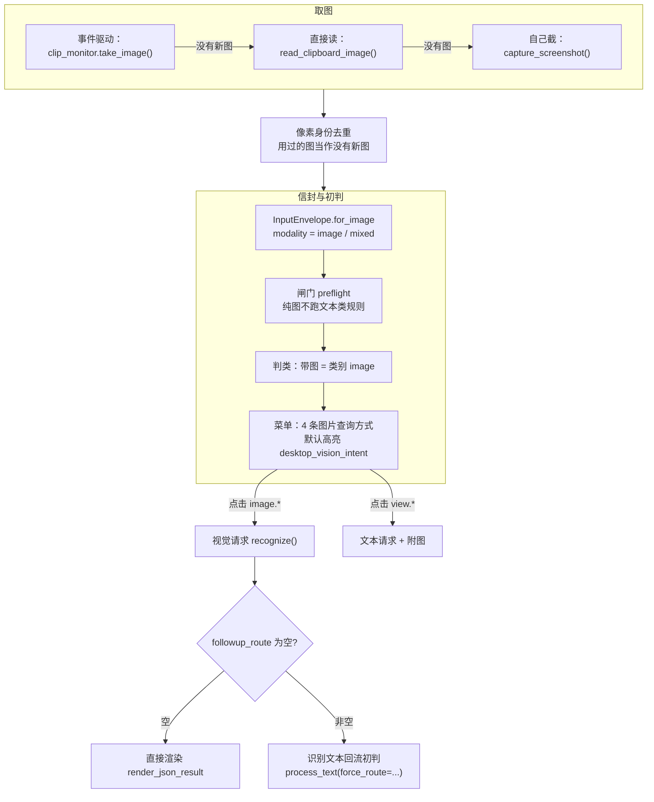

# 11 · 图片链路与提示词组装机制

本文只讲一件事：**按下截图之后，到看见答案之间发生了什么**，以及为什么
图片侧需要「一层模板 + 多种模式」，而不是像文本侧那样「一个类别一个模板」。
最后一节是给未来加功能用的检查清单。

- 源码：`src/clipllm02/studio/{app,vision,json_render}.py`、`suggest.py`
- 规格：`spec/builtin_intents.json`、`spec/builtin_settings.json`
- 决策：`docs/07_DECISIONS.md` ADR-9 ~ ADR-14、ADR-32 ~ ADR-36

## 0. 一页速览



一句话：**取图 → 信封 → 判类 → 菜单 → 提示词 → 一次请求 → 两种出口**。
图片不是文本旁边的附加项，它自己就是一个类别。

## 1. 取图：三条路，一道去重

`app.on_vision()`（`app.py:874`）按顺序尝试：

| 顺序 | 来源 | 说明 |
|---|---|---|
| 1 | `clip_monitor.take_image()` | 事件驱动（`wl-paste --watch` / `QClipboard.dataChanged`），**取走即清空** |
| 2 | `read_clipboard_image()` | 直接读系统剪贴板（监听不可用时的兜底，**不消费**） |
| 3 | `capture_screenshot()` | `grim+slurp` → `gnome-screenshot -a` → `scrot/import` → xdg-portal → `QScreen` 全屏兜底 |

第 2 条是「同一张图被反复查询」的温床：它会**每次都读到同一份剪贴板内容**。
所以取到图之后必须过一道去重：

```text
_image_identity(bytes)      → 256×256 像素摘要（同一张图换编码也认得出）
if 摘要在_used_image_digests（最近 8 张）里:
        当作「没有新图」→ 继续走截屏
else:
        记账
```

- **为什么按像素不按字节**：`wl-paste` / `xclip` 对同一份剪贴板内容每次重新
  生成 PNG，字节不同、像素相同；按字节记账会认不出「还是上次那张」。
- **为什么连截出来的图也要记账**：截图工具常把截图写回剪贴板，不记账的话
  下一轮又会把它当新图。

落盘由 `AssetStore.put()` 负责（内容寻址：`~/.cache/clip-llm/assets/<sha前2位>/<sha>.png`），
内存里再留最近 8 张（`_vision_assets`），点菜单时不必回读磁盘。

## 2. 判类：带图就是图片类别

文本侧是「分类器 → 类别 → 模板 → 查询方式」。图片侧**同构**，只是判定不看内容，
只看有没有图：

| 步骤 | 代码 | 行为 |
|---|---|---|
| 判类 | `suggest.py:164` `suggest()` | 带图 → `category = vision_category(settings)`（即模板 id `image`），标签「图片识别」 |
| 抽屉 | 同上 | 文本框里文字判出的类别降级为可切换候选（初判标签右侧「其他 ▾」） |
| 菜单 | `suggest.py:255` `build_menu()` | 推荐区 = 该类别下的 4 条查询方式，按 `order` 排（10/20/30/40） |
| 默认项 | `desktop_vision_intent` | 回车 / 数字键的落点 |

关键点：**推荐区不再按模态硬插图片方式**。曾经的做法是「双模态时把图片方式
塞进推荐区最前」，结果切到中文类别仍然看得见图片方式——图片方式只能在
`image` 类别里出现。

## 3. 提示词：一重 / 两重 / 自由输入

图片侧的提示词有**三种形态**，不要混着理解。

### 3.1 一重 + 多种模式（默认，最常用）

```
routes.image.prompt                ← 模板层（一条，兜底）
  ↳ intent.prompt_override         ← 查询方式层（4 条，各自的输出契约）
      ↳ 用户附加要求（可选）        ← compose_vision_prompt() 拼在最前
```

- **模板层**（`vision_route_prompt()`，`vision.py:274`）：只写所有图片任务共通
  的约束（「只输出结果本身」「公式用 LaTeX，反斜杠双写」「看不清就说明」）。
- **方式层**（`intent.prompt_override`）：这一条方式**唯一**的输出契约。
- 组装函数：`intent_vision_prompt()`（`vision.py:314`）——`override > 模板 > 全局兜底`，
  再拼附加要求。

出厂四条方式的契约（`spec/builtin_intents.json`）：

| 方式 | order | 输出 | followup_route |
|---|---|---|---|
| `image.ocr` 提取图片中的文字 | 10 | 纯文本（`$...$` / `$$...$$`） | `auto` → 回流文本链路 |
| `image.table` 提取表格与数据 | 20 | JSON（行列结构） | 空 → 直接渲染 |
| `image.explain` 这张图在讲什么 | 30 | JSON：`type / summary / key_points / components / notes` | 空 → 直接渲染 |
| `image.annotate` 在原图标出关键处 | 40 | JSON：`boxes[{x,y,w,h,label}]` | 空 → 直接渲染 |

### 3.2 两重（回流文本链路）

`followup_route` 非空时，视觉结果**只当识别结果**，真正的解释由下游文本模板完成：

```
图片 → 视觉（image.ocr，只做转写） → 文本 → 初判（force_route=""：按识别文本正常判类）
     → 文本模板（LaTeX 公式）+ 该模板下的查询方式 → 答案
```

- `followup_route: "auto"` → 识别结果按分类器默认类别走；
- `followup_route: "latex"` → 钉死到该模板（`_pinned_intent()`，`app.py:440`）；
- 组合开关 `image.auto_continue`：默认 true，直接续跑；关掉则先看识别结果。

**为什么公式的“读懂”不放在视觉侧**：视觉模型只负责把像素转成 LaTeX，
推导、量纲、变形交给文本模板，错字风险与成本都低得多。

### 3.3 自由输入（不选方式，直接写要求）

`intent is None` 时，用户的要求**就是主指令**，不能降级成附在通用提示词后面的
「附加要求」：

- `mode="instruction"`：包一层「按下面的要求处理这张图片…」；
- `mode="prompt"`：原文即提示词。

### 3.4 有附加要求时，谁说了算

`compose_vision_prompt()`（`vision.py:293`）把用户要求放**最前面**，并把方式
提示词降级为「参考格式」：

```
用户的要求：<这次真正想问的>
请直接回答上面这个要求，不要只做文字/公式识别，也不要只输出字段清单。
【参考格式（仅在与上面要求相容时使用）】
<方式提示词>
```

原因很实际：8B 级视觉模型对结尾的「只返回识别结果」更敏感，要求放末尾会被压住，
变成只会转写、不回答。

### 3.5 「复用模板 / 专属提示词」怎么判定

唯一判据在 `models.intent_prompt_source()`（`models.py:304`）：

```text
prompt_override 非空 → 专属提示词
prompt_override 为空 → 复用模板（模板内容真的会发出去）
custom = true        → 自定义
```

不要用 `use_legacy_template` 判断——那只是「提示词来自旧脚本 9 套」的历史标记，
与本次实际发什么无关。设置页的提示词模板会显示「当前 N/M 条查询方式复用此模板」，
一眼看出模板有没有被用上。

## 4. 结果分流：两条出口

`_on_vision_done()`（`app.py:1024`）按 intent 决定出口：

| 条件 | 出口 | 说明 |
|---|---|---|
| `followup_route` 空 | `render_json_result()` 直接渲染 | 模型返回的就是答案；同时记 `_pending_content/_pending_system`，保证能追问 |
| `followup_route` 非空 | `process_text(..., source="vision")` | 识别文本进初判；`force_dedup_bypass` 跳过重复判定 |

三条硬规则：

1. **一条方式只能有一个输出契约**：要么回流文本，要么直接渲染。曾经
   `image.formula` 的路由是 `image_ocr` 却返回 JSON，于是 JSON 被当成新文本再查一遍。
2. **票据**：载荷带 `generation` + `envelope_id`，迟到或换图后的结果一律丢弃
   （`drop reason=stale-vision / stale-vision-envelope / closed-tab`）。
3. **JSON 要有自愈能力**：`_repair_json()`（`json_render.py:567`）修非法转义
   （LaTeX 单反斜杠）、尾逗号、截断；修不好就明说「按原文展示」，绝不把
   `structure` 的第一项当答案渲染。

## 5. 其他视角（`view.*`）：另一条链路

「其他视角」不是图片模板，是**自带提示词的通用解读角度**（设置 → 其他视角）：

```text
other_views.items[]  →  IntentOption.from_other_view()  →  id = "view.<vid>"
                         primary_route = general，prompt_override = 你自己写的那段
```

执行路径与图片方式不同：

| 判定 | 代码 | 行为 |
|---|---|---|
| `is_view` | `on_intent()` `app.py:575`，看 id 前缀 `view.` | 走文本模型 |
| 附图 | `_attach_image()` `app.py:728` | 有图且 `desktop_followup_image` 开 → 原图随文本一起发 |
| 正文 | `on_intent()` | 无文字时补一句「请从「X」的角度解读这张图片」 |

也就是说：**「其他视角」= 文本模型 + 图片附件**，提示词来自视角条目本身，
不叠加图片模板，也不受「提示词模板」页影响。改模板不会改视角，这是最容易误判的一点。

### 其他视角为什么容易串扰

它和「追问」共用同一条「文本 + 附图 + 历史」的链路，任何一个旧状态漏进来都会
答成上一次：

| 症状 | 根因 | 现在的防线 |
|---|---|---|
| 截八面体，回来的是上一个公式的解释，`type` 还写「公式」 | 查询框残留上一次的正文，被当成「附加要求」拼进视觉提示词 | `process_text` 也清空查询框；`_last_query_text` 命中即当残留丢弃 |
| 同一张图反复查，答案不变 | 直接读剪贴板 / 截图工具写回剪贴板 | 像素身份记账（最近 8 张） |
| 新图的结果被旧请求盖掉 | 图片链路没有票据校验 | `generation` + `envelope_id` |
| 切到中文类别还看见图片方式 | 推荐区按模态硬插图片方式 | 图片是一等类别，推荐区只来自本类别 |
| 视角结果带上一轮问答 | `chat_history` / `_followup` 残留 | `set_context → begin_new_session()` 清历史；`_followup` 用 `pop` 取用即弃 |
| 改了模板但视角没变 | 视角提示词独立于模板 | 见本节：视角提示词在 `other_views.items[].prompt` |

缓存的边界：文本结果按
`cache_key(model, route, intent, format, schema, ruleset, query_hash, salt)`
存取，`query_hash` 对图片取 **asset sha256**，所以不同图天然不同 key；
追问与 `force_dedup_bypass` 都绕开缓存。

## 6. 新增功能检查清单

### A. 加一条「图片查询方式」

1. `spec/builtin_intents.json` 加条目：`domains: ["image"]`、`primary_route: "image"`、
   `order` 顺延（现有 10/20/30/40）、`enabled: true`。
2. 写 `prompt_override`：字段清单 / 只返回结论 / JSON 契约三选一，必须包含
   「没有内容的字段给空数组或空字符串」，涉及公式要写「反斜杠双写」。
3. 决定 `followup_route`：**要回流文本就填下游模板 id**（如 `latex`），
   **直接出答案就留空**。不要既回流又自己出 JSON。
4. 输出 JSON 时优先复用 `json_render.FIELD_LABELS` 里已有的键；新键要么加进
   `FIELD_LABELS`，要么直接用中文键（中文键原样显示）。
5. 跑 `tests/test_vision_flow.py`：`IMAGE_INTENTS` 与
   「4 条方式共用一条模板」的断言需要同步。
6. 若这条方式要占「默认高亮」，改设置里的 `desktop_vision_intent` 即可，不用改代码。

### B. 加一个「其他视角」

1. 设置 → 其他视角新增：`id / label / hint / domains / order / prompt`。
2. 提示词**要写完整**（它不叠加模板）：说明从哪个角度、要不要 JSON、字段有哪些。
3. 视角默认 `primary_route = general`；`view.` 前缀是「走文本模型 + 附图」的唯一开关。
4. 想让它也适用于图片，`domains` 留空（`*`）即可；只想给图片用则填 `["image"]`。

### C. 真要再加一条「图片模板」（少见）

现在只有一条 `image`，是因为图片侧只有一种输出链路。若将来确实要拆（例如
OCR 与结构理解走不同模型），需要同步这些地方，否则会回到「模板列表里 4 个图片条目」：

1. `spec/builtin_settings.json` 的 `routes.<新id>`（`vision: true`）
2. `suggest.vision_category()` / `vision_route()`（多条时返回哪一条）
3. `settings.migrate_vision_routes()`（老配置迁移，`OLD_VISION_ROUTES` 映射）
4. `settings.validate()` 里 `desktop_vision_intent` 的校验（按 domains 判，不按路由）
5. 测试：`test_vision_flow.TestImageIntentShape`、`test_vision_prompt`

## 7. 不变量（改代码前先对照）

1. **图片是一等类别**：带图 → `category = image`；推荐区只来自该类别。
2. **一条查询方式只有一个输出契约**：回流文本 或 直接渲染，二选一。
3. **模板只做兜底**：一条方式有自己的契约时，模板不参与拼接（不是「叠加」语义）。
4. **每次视觉请求都可追溯**：`vision-start` 有 `asset / intent / chars / gen`。
5. **迟到结果一律丢弃**：generation 或 envelope 不匹配就不画。
6. **查询框不留上一次正文**：提交即清空，残留文字不得进入新截图。
7. **原始数据不丢**：缓存只存模型原始文本，排版在展示时现场生成（换字号/主题不用清缓存）。

## 8. 排障速查

```bash
CLIPLLM_DIAG=1 clip-llm02 2>&1 | grep -E "vision-|drop|submit"
```

| 事件 | 含义 |
|---|---|
| `vision-menu asset=… modality=… text_chars=…` | 取图完成，进初判；`asset` 8 位摘要就是这张图的身份 |
| `vision-skip-stale` | 剪贴板里还是用过的图，当作没有新图，转去截屏 |
| `vision-drop-residual-text` | 查询框里是上一次的正文，已丢弃 |
| `vision-start intent=… chars=… asset=… gen=…` | 真正发出视觉请求（`chars` 是提示词长度） |
| `drop reason=stale-vision` | 迟到的旧结果被丢弃 |
| `drop reason=stale-vision-envelope` | 换图之后旧信封的结果被丢弃 |
| `drop reason=closed-tab` | 标签已关闭 |
| `preflight level=… reasons=…` | 闸门结论（`reasons` 非 `-` 即被拦） |

**两轮对比法**：连续截两张不同图，比较两次 `vision-start asset=` —— 相同说明
图没换（取图问题），不同说明图换了（提示词/结果问题）。

## 9. 代码地图

| 关注点 | 位置 |
|---|---|
| 取图 + 去重 + 落盘 | `studio/app.py:832` `_image_identity`、`:851` `_fresh_clipboard_image`、`:874` `on_vision` |
| 截图实现（三级回退） | `studio/vision.py:102` `capture_screenshot` |
| 图片信封 / 判类 | `studio/app.py:947` `_present_envelope`、`suggest.py:67` `vision_category` |
| 菜单与默认项 | `suggest.py:255` `build_menu`、`:89` `vision_default_intent` |
| 提示词组装 | `studio/vision.py:293` `compose_vision_prompt`、`:314` `intent_vision_prompt` |
| 发请求 / 收结果 | `studio/app.py:975` `_start_vision`、`:1024` `_on_vision_done` |
| 结果渲染与 JSON 自愈 | `studio/json_render.py:731` `render_json_result`、`:567` `_repair_json` |
| 其他视角 | `models.py:266` `from_other_view`、`app.py:575` `is_view` 分支、`:728` `_attach_image` |
| 提示词来源判定 | `models.py:304` `intent_prompt_source` |
| 老配置迁移 | `settings.py:246` `migrate_vision_routes` |
